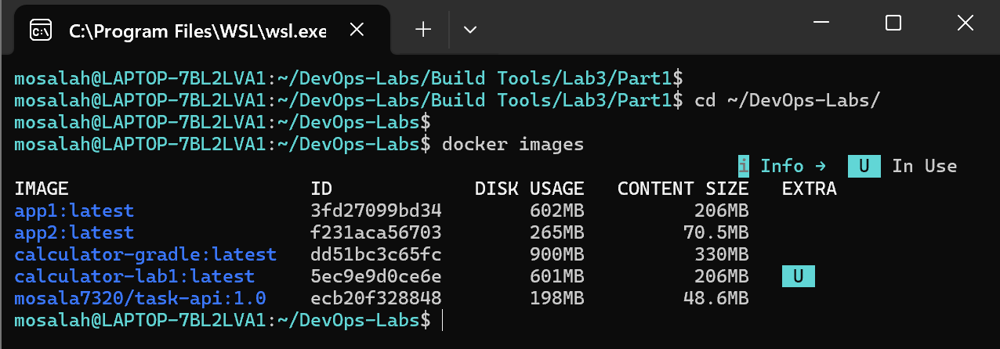

# Lab 3: Creating a Docker Image for a Java Application

This comprehensive lab demonstrates two different approaches for containerizing a Java Maven Calculator application using Docker, adhering to single-stage build requirements and security best practices (Non-root users), followed by a comparative size analysis (Bonus).

---

## 📂 Project Structure
```text
Lab-3/
├── Part-1/
│   ├── Dockerfile
│   └── screenshots/
├── Part2/
│   ├── Dockerfile
│   └── screenshots/
├── size-of-two-images.png
└── README.md
```

---

## 🛠️ Part 1: Build Inside Docker

In this part, the application source code is built directly inside a heavy Docker image containing the full Java SDK and Maven build tools.

📌 Key Implementation Steps:

1.Cloned the application code.

2.Configured a single-stage Dockerfile using the maven:3.10-eclipse-temurin-17-alpine image.

3.Created a working directory and a secure non-root security user (appuser).
Built the application inside the container using mvn package and exposed port 8080.

---

## 🚀 Part 1 Dockerfile
```bash
FROM maven:3.10-eclipse-temurin-17-alpine

RUN addgroup -S appgroup && adduser -S appuser -G appgroup

WORKDIR /app
RUN chown appuser:appgroup /app

USER appuser

COPY --chown=appuser:appgroup . .

RUN mvn package

EXPOSE 8080

CMD ["java", "-jar", "target/calculator.jar"]
```
---

## 🛠️ Part 2: Build Locally (Slim Runtime)

In this part, the application is compiled locally on the host machine using Maven, and only the lightweight .jar artifact is copied into a minimal Java Runtime image.

📌 Key Implementation Steps:

1.Built the application locally using Maven (mvn package).

2.Used a lightweight runtime image: eclipse-temurin:17-jre-alpine.

3.Configured a non-root user (appuser) for enhanced runtime security.

4.Copied only the compiled target/calculator.jar into the container.

---

## 🚀 Part 2 Dockerfile
```bash
FROM eclipse-temurin:17-jre-alpine

WORKDIR /app

RUN addgroup -S appgroup && adduser -S appuser -G appgroup
USER appuser

COPY --chown=appuser:appgroup target/calculator.jar app.jar

EXPOSE 8080

CMD ["java", "-jar", "app.jar"]
```
---

## 🏆 Bonus: Image Size Comparison & Explanation

A comparative analysis between the two deployment approaches highlights the significant impact of build strategies and image selections on final Docker image sizes:



### 📊 Size Breakdown:
- **Part 1 Image (`app1` - Build Inside Docker):**
  - **Size:** **206 MB** (Content Size) / ~602 MB (Disk Usage).
  - **Reason:** Built using the heavy `maven` SDK image, which includes compilers, the full JDK, build tools, and dependency caches required to compile the source code inside the container.

- **Part 2 Image (`app2` - Build Locally):**
  - **Size:** **70.5 MB** (Content Size) / ~265 MB (Disk Usage).
  - **Reason:** Built using a lightweight Java 17 Runtime Environment (`eclipse-temurin:17-jre-alpine`), containing strictly what is needed to execute the pre-compiled `.jar` file without any development SDKs.

### 💡 Key Takeaway & Conclusion:
By building the application locally and packaging it into a slim runtime image, we achieved a **massive reduction of nearly 65% in image size** (`206MB` down to `70.5MB`). This optimization drastically improves deployment speeds, reduces storage overhead, and enhances security by minimizing the attack surface.

---

## 📸 Verification Screenshots

Part 1 Screenshots: Located in Part-1/screenshots/ (showing build success, run verification, and cleanup).

Part 2 Screenshots: Located in Part2/screenshots/ (showing local build, image creation, and application execution).

---

