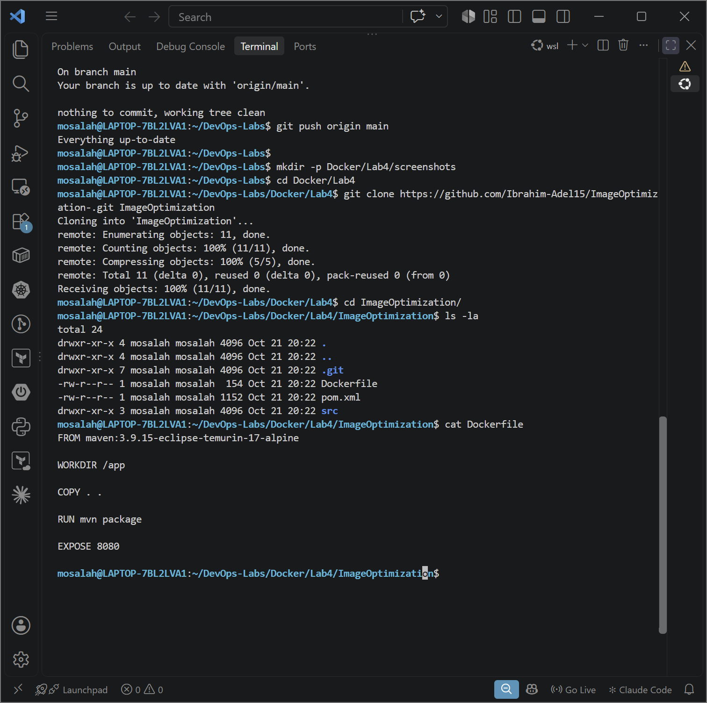
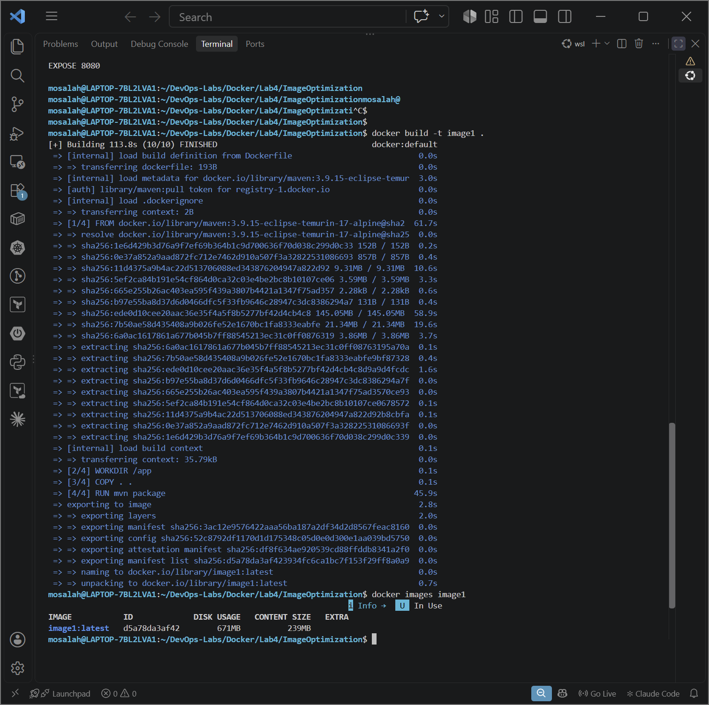
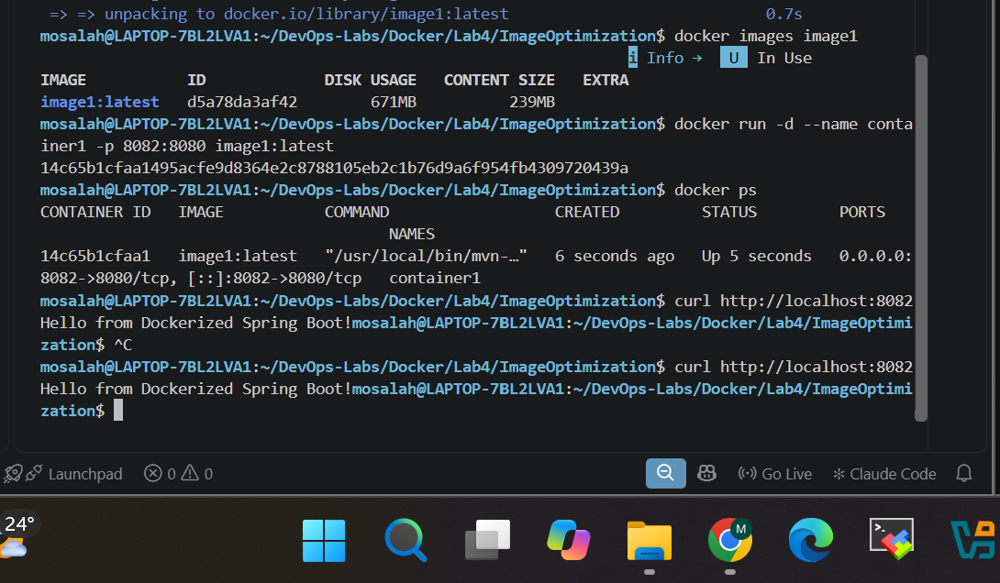
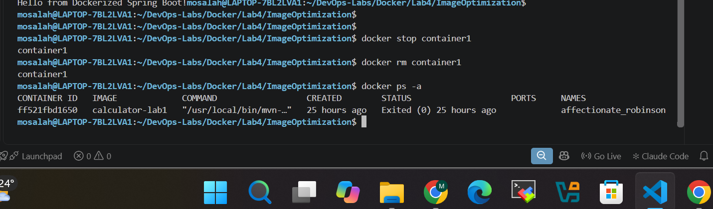
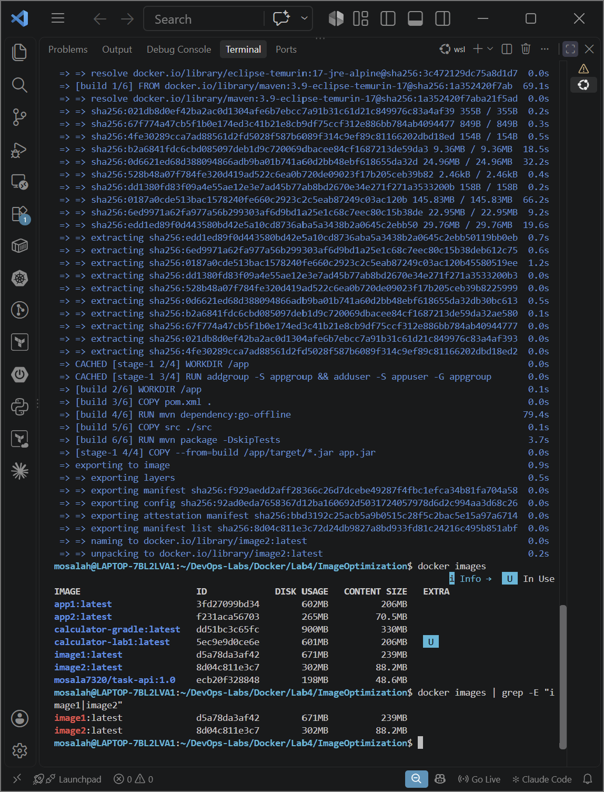
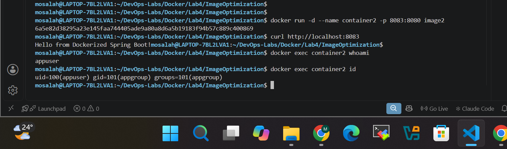
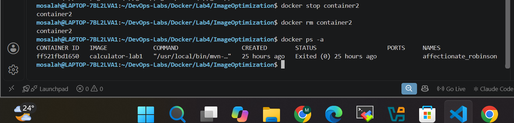
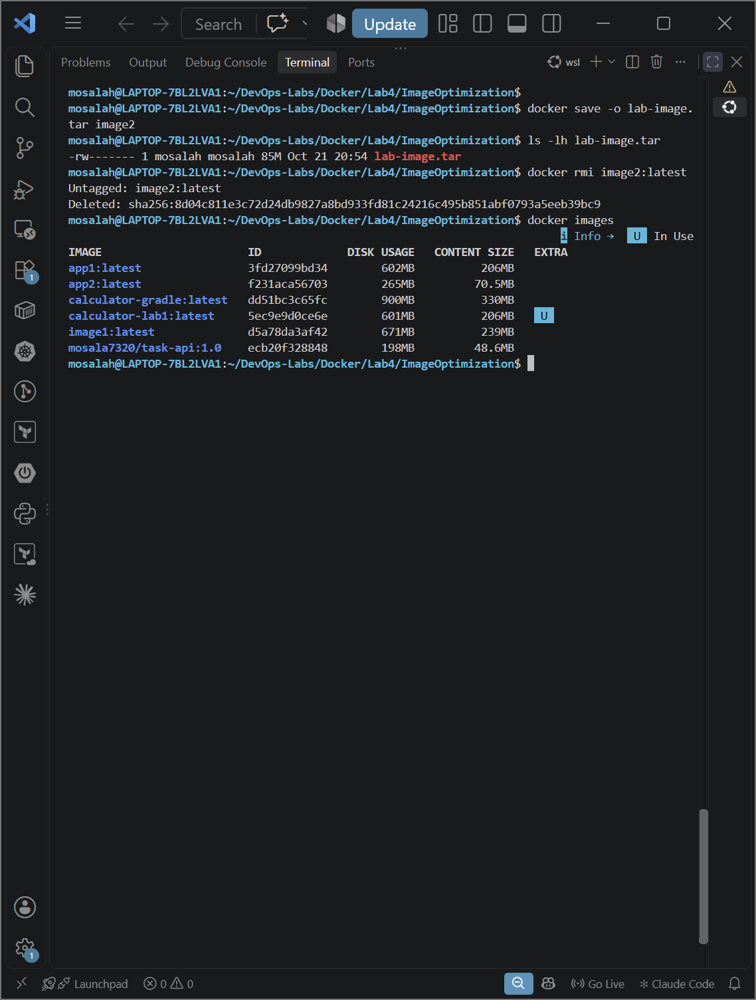
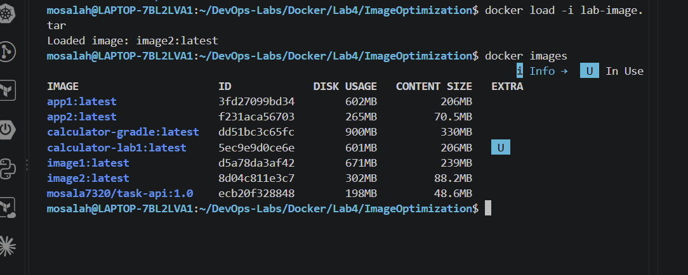

# Lab 4: Docker Image Optimization and Export/Load

This lab takes a Java (Maven) application, builds it into a Docker image with the **existing single-stage Dockerfile**, then optimizes it with a **multi-stage Dockerfile that runs as a non-root user**, compares the two image sizes, and finally **exports the optimized image to a TAR file and loads it back**.

---

## 📁 Project Structure

```text
Lab4/
├── ImageOptimization/
│   ├── Dockerfile              # original single-stage Dockerfile  -> image1
│   ├── Dockerfile.multistage   # optimized multi-stage, non-root   -> image2
│   ├── pom.xml
│   └── src/
├── screenshots/                # proof of the steps
└── README.md
```

> `lab-image.tar` is generated locally and is **not committed** (it is listed in `.gitignore`).

---

## 🎯 Objectives

1. Build an image from the existing Dockerfile (`image1`) and note its size.
2. Run `container1`, verify the app, then stop and delete it.
3. Write a multi-stage Dockerfile that runs the app as a non-root user.
4. Build the optimized image (`image2`) and compare its size with `image1`.
5. Run `container2`, verify the app, and verify it runs as a non-root user.
6. Stop and delete `container2`.
7. Save `image2` as `lab-image.tar`, delete `image2`, load it back from the TAR, and verify it was restored.

> **Note on ports:** port `8080` is already used by Jenkins on my machine, so the host ports used here are **8082** (`container1`) and **8083** (`container2`). The application listens on `8080` inside the container.

---

## 🛠️ Steps

### 1. Clone the application

```bash
git clone https://github.com/Ibrahim-Adel15/ImageOptimization-.git ImageOptimization
cd ImageOptimization
ls -la
cat Dockerfile
```



### 2. Build `image1` from the existing Dockerfile

```bash
docker build -t image1 .
docker images image1
```



### 3. Run `container1` and verify the application

```bash
docker run -d --name container1 -p 8082:8080 image1
docker ps
curl http://localhost:8082
```



### 4. Stop and delete `container1`

```bash
docker stop container1
docker rm container1
docker ps -a
```



### 5. Write the multi-stage Dockerfile (non-root user)

The optimized Dockerfile is in [`ImageOptimization/Dockerfile.multistage`](ImageOptimization/Dockerfile.multistage).

| Stage | Base image | Purpose |
|-------|-----------|---------|
| `build` | `maven:3.9-eclipse-temurin-17` | Downloads dependencies and packages the application into a JAR |
| runtime | `eclipse-temurin:17-jre-alpine` | Runs only the JAR, with no build tools |

Key points:

- Only the final JAR is copied from the build stage (`COPY --from=build`), so Maven, the build cache, and the source code are **not** part of the final image.
- A dedicated user and group are created (`addgroup` / `adduser`), and the app runs with `USER appuser` instead of `root`.
- `pom.xml` is copied and dependencies are resolved **before** copying `src`, so Docker can cache the dependency layer.

### 6. Build `image2` and compare the sizes

```bash
docker build -f Dockerfile.multistage -t image2 .
docker images | grep -E "image1|image2"
```



#### 📊 Size comparison

| Image | Disk usage | Content size (compressed) |
|-------|-----------:|--------------------------:|
| `image1` (single-stage) | **671 MB** | **239 MB** |
| `image2` (multi-stage) | **302 MB** | **88.2 MB** |
| **Reduction** | **369 MB (~55%)** | **150.8 MB (~63%)** |

> `docker images` shows two values: **Disk usage** is the size on disk after the layers are unpacked, and **Content size** is the compressed size of the image content (roughly what is transferred when pushing or pulling).

### 7. Run `container2` and verify the application and the non-root user

```bash
docker run -d --name container2 -p 8083:8080 image2
docker ps
curl http://localhost:8083

docker exec container2 whoami      # expected: appuser (not root)
docker exec container2 id
```



### 8. Stop and delete `container2`

```bash
docker stop container2
docker rm container2
docker ps -a
```



### 9. Save `image2` as a TAR file and delete it from the local Docker host

```bash
docker save -o lab-image.tar image2
ls -lh lab-image.tar

docker rmi image2
docker images
```



### 10. Load the image back from the TAR file and verify it was restored

```bash
docker load -i lab-image.tar
docker images image2
```



---

## 🧹 Cleanup (optional)

```bash
docker rmi image1 image2
rm lab-image.tar
```

---

## 💡 Key Takeaways

- **Multi-stage builds** keep build tools out of the final image: the same application went from 671 MB to 302 MB on disk.
- **Running as non-root** limits what an attacker can do if the application is compromised.
- **Layer order matters:** copying `pom.xml` and resolving dependencies before copying the source lets Docker reuse the cached dependency layer.
- **`docker save` / `docker load`** move an image between machines without a registry, which is useful for offline or air-gapped environments.
- **Host ports are a local choice:** when a port is already taken (Jenkins on 8080), map a different host port (`-p 8082:8080`) without changing the application.

