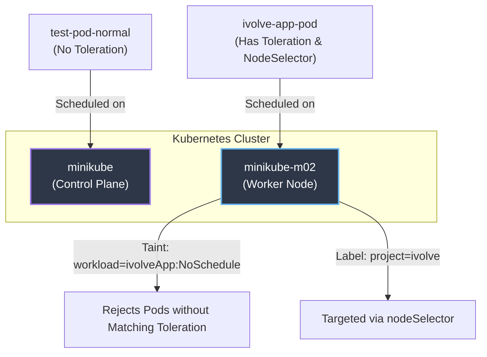
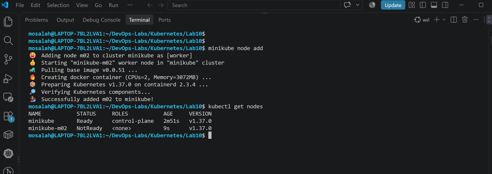
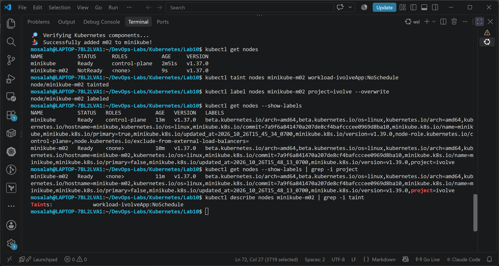
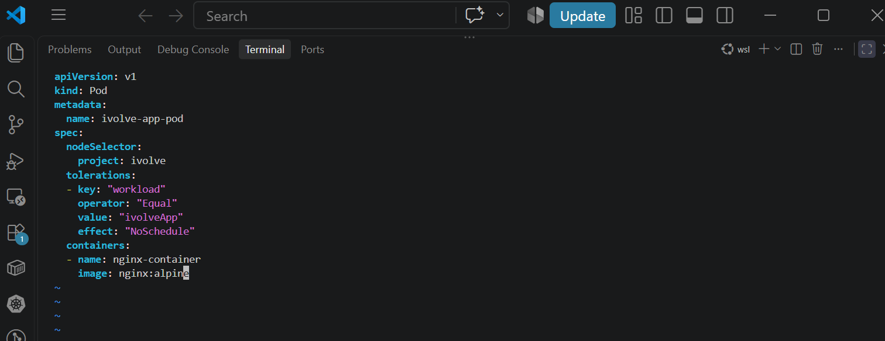
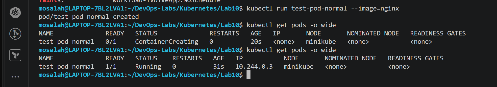
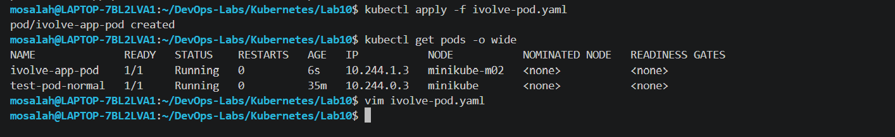

# Lab 10: Node Isolation Using Taints and Labels in Kubernetes

## 🏗️ Architecture Overview

The following diagram illustrates how **Taints**, **Tolerations**, and **Labels** interact within the multi-node Minikube cluster to enforce strict node isolation and targeted pod scheduling:



---

## 🎯 Lab Objectives
1. **Provision a Multi-Node Cluster**: Add a secondary worker node (`minikube-m02`) to emulate a realistic cluster environment.
2. **Apply Node Taints**: Configure a `NoSchedule` taint on the target worker node to reject standard workloads.
3. **Apply Node Labels**: Assign specific key-value labels to enable precise workload targeting.
4. **Deploy & Validate Workloads**:
   - Verify that un-tolerated pods are diverted away from the tainted node.
   - Verify that pods with matching tolerations and `nodeSelector` fields are correctly scheduled on the isolated node.

---

## 🛠️ Execution & Implementation

### 1. Multi-Node Cluster Provisioning
To test node isolation effectively, a worker node (`minikube-m02`) was added to the active cluster:
```bash
minikube node add
kubectl get nodes
```


### 2. Configuring Taints and Node Labels
The worker node `minikube-m02` was configured with a project label and a `NoSchedule` taint:
```bash
# Label the node for project targeting
kubectl label nodes minikube-m02 project=ivolve --overwrite

# Taint the node to prevent unauthorized pod placement
kubectl taint nodes minikube-m02 workload=ivolveApp:NoSchedule --overwrite
```


### 3. Creating the Pod Manifest (`ivolve-pod.yaml`)
A custom manifest was generated using declarative dry-run commands and updated with the matching `tolerations` and `nodeSelector`:
```bash
kubectl run ivolve-app-pod --image=nginx:alpine --dry-run=client -o yaml > ivolve-pod.yaml
```

**File Content (`ivolve-pod.yaml`):**
```yaml
apiVersion: v1
kind: Pod
metadata:
  name: ivolve-app-pod
spec:
  nodeSelector:
    project: ivolve
  tolerations:
  - key: "workload"
    operator: "Equal"
    value: "ivolveApp"
    effect: "NoSchedule"
  containers:
  - name: nginx-container
    image: nginx:alpine
```


---

## 🧪 Verification & Bonus Testing

### Test A: Untolerated Pod Placement
A generic pod without tolerations (`test-pod-normal`) was created to confirm that the Kubernetes scheduler avoids the tainted node (`minikube-m02`) and places it on the control plane node (`minikube`):
```bash
kubectl run test-pod-normal --image=nginx
kubectl get pods -o wide
```


### Test B: Tolerated Pod Placement
The manifest `ivolve-pod.yaml` was applied. Thanks to its matching `toleration` and `nodeSelector`, the pod successfully passed the taint validation and landed on `minikube-m02`:
```bash
kubectl apply -f ivolve-pod.yaml
kubectl get pods -o wide
```


---

## 📝 Conclusion
By pairing **Taints & Tolerations** (repulsion/isolation mechanics) with **Labels & NodeSelectors** (attraction mechanics), we achieved complete control over pod placement across the cluster topology.
