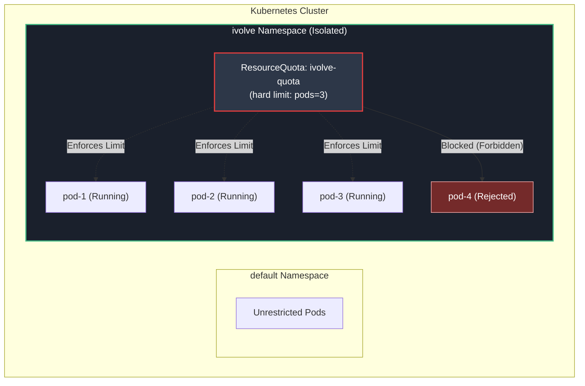
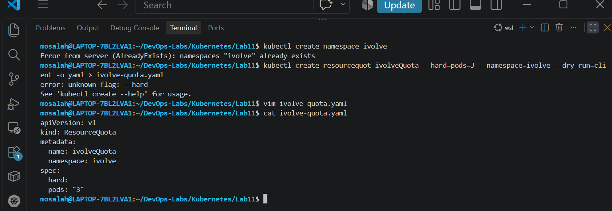
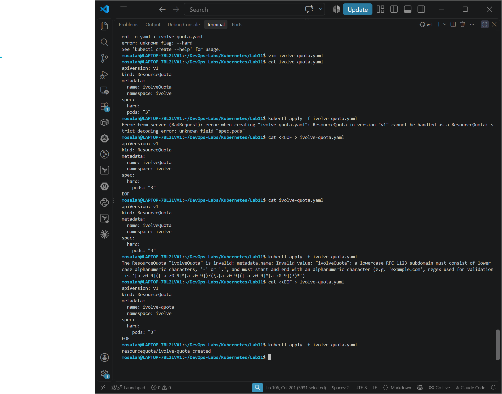
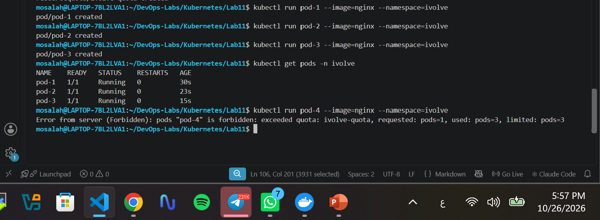
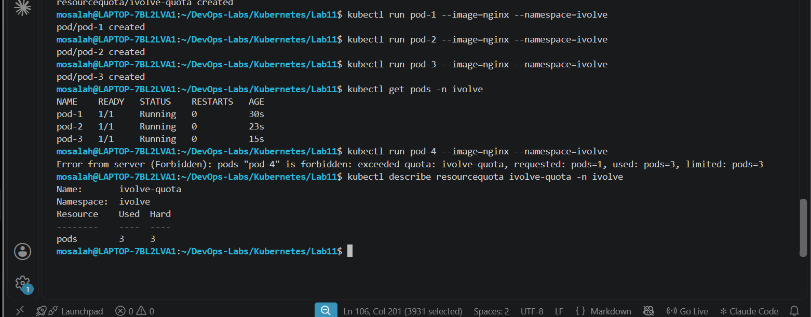

# Lab 11: Namespace Management and Resource Quota Enforcement

## 🏗️ Architecture Overview

The following diagram illustrates how the `ResourceQuota` operates within the isolated `ivolve` namespace to strictly limit total active pod instances to a maximum of 3:



## 🎯 Lab Objectives

1. **Namespace Isolation**: Create a dedicated Kubernetes namespace (`ivolve`) to isolate application workloads and administrative boundaries.
2. **Resource Quota Enforcement**: Define and apply a `ResourceQuota` named `ivolve-quota` restricting the maximum number of concurrent pods inside the namespace to **3**.
3. **Quota Verification & Testing**: Deploy workloads up to the defined quota limit and verify that Kubernetes active admission control rejects any deployment exceeding the threshold.

---

## 🛠️ Step-by-Step Implementation

### Step 1: Create the Isolated Namespace

First, create the target `ivolve` namespace to host the restricted environment:

```bash
kubectl create namespace ivolve
```



---

### Step 2: Define and Apply the ResourceQuota Manifest

Create the `ivolve-quota.yaml` manifest specifying the `pods: "3"` constraint under the `spec.hard` field.

> **Note**: Resource names in Kubernetes must conform to RFC 1123 standards (lowercase letters, numbers, or hyphens).

**Manifest File (`ivolve-quota.yaml`):**

```yaml
apiVersion: v1
kind: ResourceQuota
metadata:
  name: ivolve-quota
  namespace: ivolve
spec:
  hard:
    pods: "3"
```

Apply the quota definition to the `ivolve` namespace:

```bash
kubectl apply -f ivolve-quota.yaml
```



---

### Step 3: Deploy Workloads & Test Quota Enforcement

1. **Deploy Pod 1 to 3** up to the hard limit threshold:

   ```bash
   kubectl run pod-1 --image=nginx --namespace=ivolve
   kubectl run pod-2 --image=nginx --namespace=ivolve
   kubectl run pod-3 --image=nginx --namespace=ivolve
   ```

2. **Verify Pod Status**:

   ```bash
   kubectl get pods -n ivolve
   ```

3. **Trigger Quota Rejection**: Attempt to create a 4th pod exceeding the quota limit:

   ```bash
   kubectl run pod-4 --image=nginx --namespace=ivolve
   ```

   **Expected Output (Forbidden Error):**
   ```text
   Error from server (Forbidden): pods "pod-4" is forbidden: exceeded quota: ivolve-quota, requested: pods=1, used: pods=3, limited: pods=3
   ```



---

### Step 4: Inspect Quota Usage Details (Bonus Verification)

Inspect the live resource usage against configured hard limits within the namespace:

```bash
kubectl describe resourcequota ivolve-quota -n ivolve
```

**Output Details:**
* **Resource**: `pods`
* **Used**: `3`
* **Hard**: `3`



---

## 📝 Conclusion

Through the implementation of `ResourceQuota` resources, multi-tenant cluster environments can enforce strict object limits per namespace. This prevents resource starvation, guarantees capacity management, and blocks unauthorized pod expansions.
