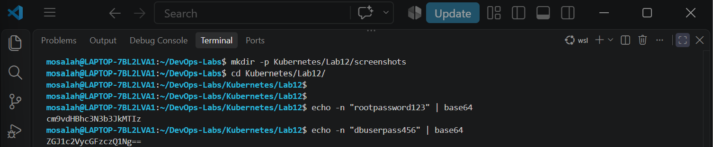
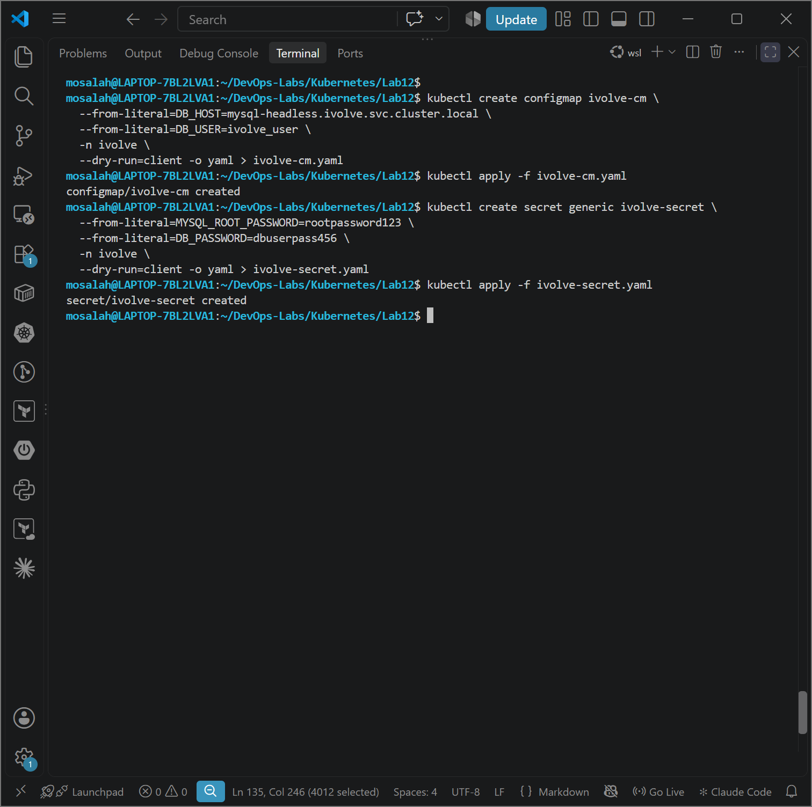
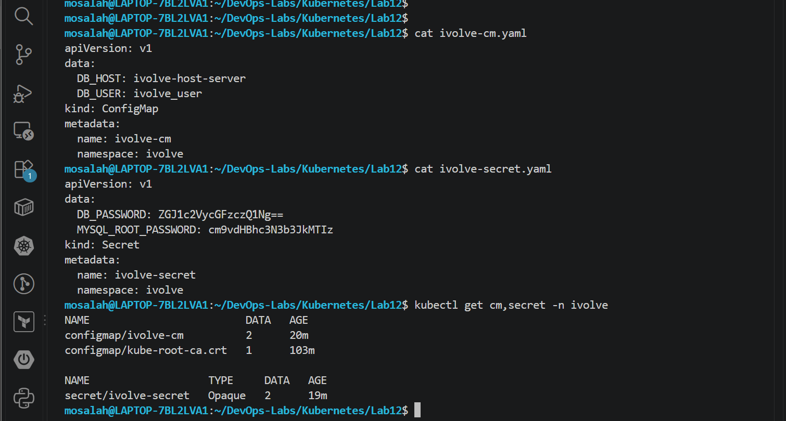
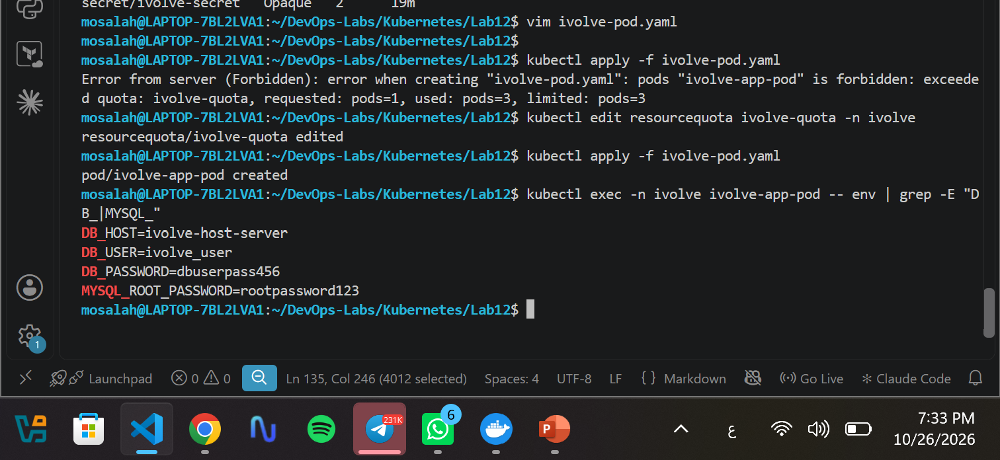

# Lab 12: Managing Configuration and Sensitive Data with ConfigMaps and Secrets

## Overview
This laboratory demonstrates the recommended Kubernetes best practices for decoupling application configuration state and sensitive credentials from container images. It highlights the functional differences between non-sensitive environment variables managed via `ConfigMap` and encrypted credentials managed via `Secret`.

---

## Technical Specifications

| Resource Name | Kind | Namespace | Key-Value Pairs / Description |
| :--- | :--- | :--- | :--- |
| **`ivolve-cm`** | `ConfigMap` | `ivolve` | `DB_HOST`: Database server host<br>`DB_USER`: Application database user |
| **`ivolve-secret`** | `Secret` | `ivolve` | `MYSQL_ROOT_PASSWORD`: Base64 encoded root password<br>`DB_PASSWORD`: Base64 encoded database user password |
| **`ivolve-app-pod`** *(Bonus)* | `Pod` | `ivolve` | Verification Pod consuming `ConfigMap` & `Secret` key-values as environment variables |

---

## Key Concepts & Standards

### 1. Plaintext vs Base64 Encoding
* **ConfigMap (`ivolve-cm`)**: Used for storing standard non-confidential data in plain text.
* **Secret (`ivolve-secret`)**: Used for storing sensitive credentials. Values inside the YAML manifest must be Base64-encoded to protect credentials from direct visual exposure.

### 2. RFC 1123 Compliance
* Kubernetes metadata resource names require lowercase alphanumeric characters, `-` or `.`. Uppercase characters (e.g., `ivolveCM` or `ivolveSecret`) are rejected by the Kubernetes API server. Therefore, standardized lowercase names (`ivolve-cm` and `ivolve-secret`) were used.

---

## Step-by-Step Implementation

### Step 1: Base64 Encoding Data Values
Before creating the Secret manifest, sensitive data values are encoded using Base64:

```bash
echo -n "rootpassword123" | base64
echo -n "dbuserpass456" | base64
```



---

### Step 2 & 3: Declarative Generation & Deployment
Using imperative `--dry-run=client -o yaml` commands to generate reproducible YAML manifests for both `ConfigMap` and `Secret` within the `ivolve` namespace:

```bash
# Generate ConfigMap manifest
kubectl create configmap ivolve-cm \
  --from-literal=DB_HOST=ivolve-host-server \
  --from-literal=DB_USER=ivolve_user \
  -n ivolve \
  --dry-run=client -o yaml > ivolve-cm.yaml

# Apply ConfigMap
kubectl apply -f ivolve-cm.yaml

# Generate Secret manifest
kubectl create secret generic ivolve-secret \
  --from-literal=MYSQL_ROOT_PASSWORD=rootpassword123 \
  --from-literal=DB_PASSWORD=dbuserpass456 \
  -n ivolve \
  --dry-run=client -o yaml > ivolve-secret.yaml

# Apply Secret
kubectl apply -f ivolve-secret.yaml
```



---

### Step 4: Verification
Verifying that both resources exist and are active inside the `ivolve` namespace:

```bash
kubectl get cm,secret -n ivolve
```



---

## Bonus: End-to-End Application Integration Test

To demonstrate actual application consumption:
1. Adjusted the namespace `ResourceQuota` limit (`ivolve-quota`) from Lab 11 to accommodate additional pod workloads.
2. Deployed an application Pod (`ivolve-app-pod`) that mounts values from `ivolve-cm` and `ivolve-secret` as environment variables.
3. Verified the injected environment variables directly inside the running container:

```bash
kubectl exec -n ivolve ivolve-app-pod -- env | grep -E "DB_|MYSQL_"
```


