# Lab 14: StatefulSet with Headless Service

Deploy a MySQL database as a **StatefulSet** in the `ivolve` namespace, exposed through a **headless Service**, with storage created automatically by a **StorageClass** (dynamic provisioning).

## Lab requirements

| Requirement | How it is done |
|---|---|
| `ivolveDB` StatefulSet in `ivolve` ns, 1 replica running MySQL | `statefulset.yaml` (`ivolvedb`, `replicas: 1`, `mysql:8.4`) |
| Consume environment variables from the ConfigMap and Secret | `env` with `configMapKeyRef` and `secretKeyRef` (Lab 12 objects) |
| Node selector for the node labeled `project=ivolve` | `nodeSelector: project: ivolve` |
| Toleration for `workload=ivolveApp` with `NoSchedule` | `tolerations` entry in the pod spec |
| PVC template mounted at `/var/lib/mysql` | `volumeClaimTemplates` + `volumeMounts` |
| Headless Service named `ivolveDBSvc` | `headless-svc.yaml` (`clusterIP: None`) |
| Confirm the database is operational with a MySQL client | `mysql` client connection through the Service |
| Verify the MySQL pod DNS resolution inside the cluster | `nslookup` and `getent hosts` |

> Kubernetes object names must be lowercase (RFC 1123), so `ivolveDB` and `ivolveDBSvc` are created as `ivolvedb` and `ivolvedbsvc`.

## Environment

- 3-node kubeadm cluster (1 control-plane + 2 workers) on VirtualBox, Calico CNI
- Namespace `ivolve` with a ResourceQuota of 3 pods (Lab 11)
- ConfigMap `ivolvecm` and Secret `ivolvesecret` (Lab 12)
- `worker-node-1` labeled `project=ivolve` and tainted `workload=ivolveApp:NoSchedule` (Lab 10)

## Files

| File | Purpose |
|---|---|
| [`headless-svc.yaml`](headless-svc.yaml) | Headless Service `ivolvedbsvc` |
| [`statefulset.yaml`](statefulset.yaml) | StatefulSet `ivolvedb` with the PVC template |
| [`screenshots/`](screenshots) | Evidence for each step |

## How the pieces connect

```
ConfigMap (DB_HOST, DB_USER) ─┐
Secret (passwords) ───────────┼──> StatefulSet ivolvedb ──> pod ivolvedb-0 (worker-node-1)
nodeSelector + toleration ────┘            │                        │
                                           │                        └─ /var/lib/mysql
Headless Service ivolvedbsvc <─ serviceName│                              │
(stable DNS per pod)                       └─ volumeClaimTemplates ──> PVC ──> PV (auto-created)
                                                 StorageClass: local-path
```

## Why a StorageClass?

The cluster was built with kubeadm, so it has no StorageClass by default. To let the PVC template get its volume automatically, I installed Rancher's **local-path-provisioner**. It creates a PersistentVolume on the node's disk whenever a PVC asks for the `local-path` StorageClass, so no PV has to be written by hand. (Lab 13 intentionally used a manually created PV with no StorageClass, which is a different approach.)

---

## Steps

### 1. Check the prerequisites

```bash
kubectl get ns ivolve
kubectl get cm,secret -n ivolve
kubectl describe node worker-node-1 | grep -i -E "taints|project"
```

The StatefulSet depends on the namespace, the ConfigMap and Secret from Lab 12, and the label and taint from Lab 10.

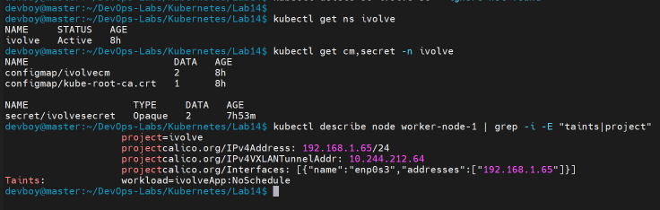

### 2. Install the StorageClass provisioner

```bash
kubectl apply -f https://raw.githubusercontent.com/rancher/local-path-provisioner/v0.0.36/deploy/local-path-storage.yaml
kubectl get pods -n local-path-storage
kubectl get sc
```

This creates the `local-path-storage` namespace with the provisioner pod and the `local-path` StorageClass. Look for the pod in `Running` state and `local-path` in the StorageClass list.

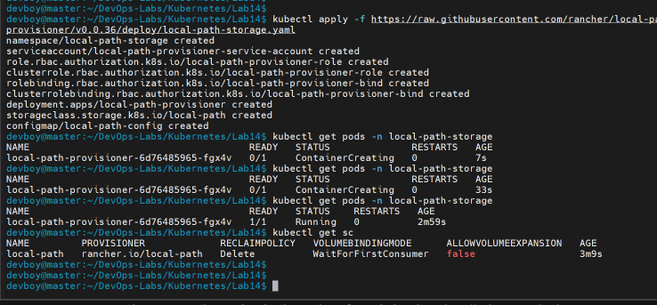

### 3. Create the headless Service

```bash
kubectl apply -f headless-svc.yaml
kubectl get svc -n ivolve
```

`clusterIP: None` makes the Service headless: no virtual IP and no load balancing, and DNS returns the pod IP directly. This gives each StatefulSet pod a stable DNS name such as `ivolvedb-0.ivolvedbsvc`. Look for `CLUSTER-IP` set to `None`.

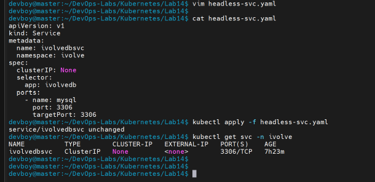

### 4. Write the StatefulSet manifest

[`statefulset.yaml`](statefulset.yaml) highlights:

- `serviceName: ivolvedbsvc` links the StatefulSet to the headless Service.
- `nodeSelector` and `tolerations` place the pod on the node labeled `project=ivolve`, which is tainted with `workload=ivolveApp:NoSchedule`. Both are needed: the selector attracts the pod and the toleration allows it past the taint.
- `env` maps ConfigMap and Secret keys to the variable names the MySQL image expects (`MYSQL_USER`, `MYSQL_PASSWORD`, `MYSQL_ROOT_PASSWORD`), so no password appears in the manifest. `MYSQL_DATABASE` creates the `ivolve` database.
- `volumeClaimTemplates` creates one PVC per pod, requesting 1Gi from the `local-path` StorageClass, mounted at `/var/lib/mysql`.

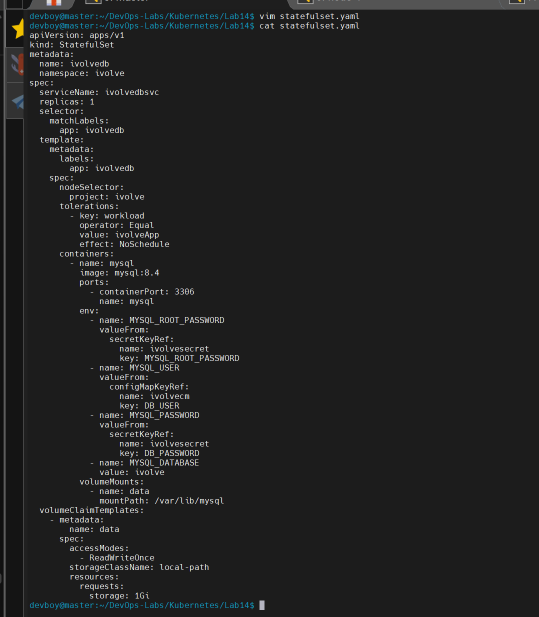

### 5. Apply the StatefulSet

```bash
kubectl apply -f statefulset.yaml
kubectl get pods -n ivolve -w
```

The first start pulls the MySQL image, so it can take a minute or two. Wait for `ivolvedb-0` to show `1/1 Running`.

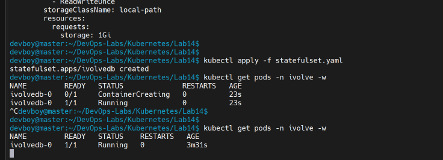

### 6. Verify the StatefulSet, PVC and the auto-created PV

```bash
kubectl get sts,pods,pvc,pv -n ivolve -o wide
```

Look for:

- the pod `ivolvedb-0` running on `worker-node-1`
- the PVC `data-ivolvedb-0` in `Bound` state with `STORAGECLASS` `local-path`
- a PV named `pvc-<uid>` that nobody wrote by hand: the provisioner created it automatically

The same output also lists `ivolvepv` and `ivolvepvc` from Lab 13. Those were created manually without a StorageClass, which makes the difference with the auto-created PV easy to see.

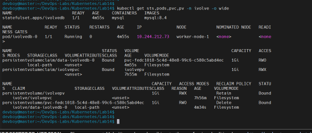

### 7. Check how the volume was provisioned

```bash
kubectl describe pvc data-ivolvedb-0 -n ivolve
```

The Events section shows the claim waiting for the first consumer (`WaitForFirstConsumer`) and then being provisioned. The volume is only created once the scheduler has chosen a node for the pod, which is the normal behavior for node-local storage.

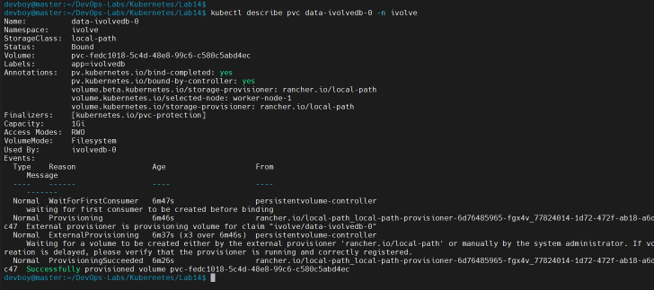

### 8. Check the pod configuration

```bash
kubectl describe pod ivolvedb-0 -n ivolve | grep -E "Node:|Node-Selectors|MYSQL|/var/lib/mysql"
```

Look for the node (`worker-node-1`), the `project=ivolve` node selector, the `MYSQL_*` variables pointing to the Secret `ivolvesecret` and the ConfigMap `ivolvecm` (the values themselves are not shown), and the mount at `/var/lib/mysql`.

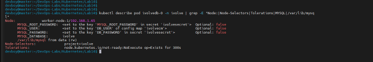

Then check the tolerations:

```bash
kubectl describe pod ivolvedb-0 -n ivolve | grep -A3 "^Tolerations"
```

Next to the default tolerations that Kubernetes adds to every pod, the `workload=ivolveApp:NoSchedule` toleration from the manifest is listed.

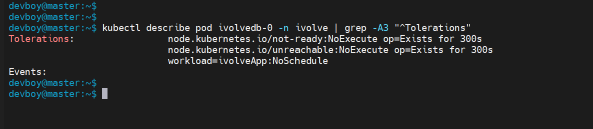

### 9. Connect with a MySQL client

```bash
kubectl exec -it ivolvedb-0 -n ivolve -- mysql -h ivolvedbsvc -u ivolve_user -p
```

```sql
SHOW DATABASES;
SELECT CURRENT_USER();
USE ivolve;
exit
```

Connecting with `-h ivolvedbsvc` goes through the headless Service, so this checks both the database and the Service. The `ivolve` database exists and the session runs as `ivolve_user`.

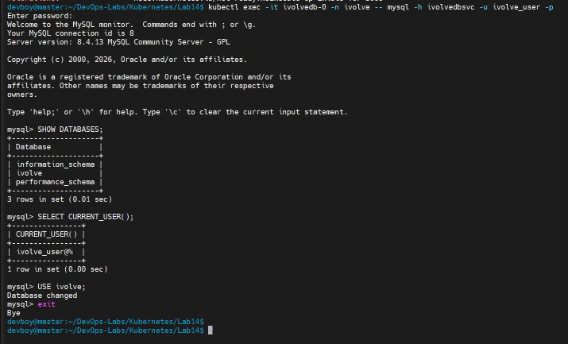

### 10. Verify DNS resolution inside the cluster

```bash
kubectl run dns-test --rm -it --restart=Never --image=busybox:1.36 -n ivolve --pod-running-timeout=5m -- nslookup ivolvedbsvc
kubectl exec -it ivolvedb-0 -n ivolve -- getent hosts ivolvedbsvc
kubectl exec -it ivolvedb-0 -n ivolve -- getent hosts ivolvedb-0.ivolvedbsvc.ivolve.svc.cluster.local
```

Because the Service is headless, the names resolve to the pod IP itself (`10.244.x.x`), not to a ClusterIP.

Note: BusyBox `nslookup` first tries the search domains, so a few `NXDOMAIN` lines appear and the temporary pod ends with an `Error` status. This is only how that tool behaves; the fully qualified name `ivolvedbsvc.ivolve.svc.cluster.local` is resolved to the pod IP, and `getent` returns the same address for both names.

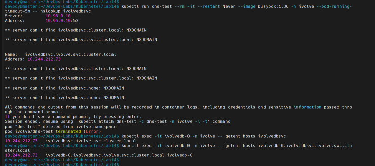

### 11. Verify data persistence

```bash
kubectl exec ivolvedb-0 -n ivolve -- sh -c 'mysql -u root -p"$MYSQL_ROOT_PASSWORD" -e "CREATE TABLE ivolve.t1 (id INT); INSERT INTO ivolve.t1 VALUES (1);"'
kubectl delete pod ivolvedb-0 -n ivolve
kubectl get pods -n ivolve -w
kubectl exec ivolvedb-0 -n ivolve -- sh -c 'mysql -u root -p"$MYSQL_ROOT_PASSWORD" -e "SELECT * FROM ivolve.t1;"'
```

The root password is read from the `MYSQL_ROOT_PASSWORD` environment variable inside the container (which comes from the Secret), so no password is typed or shown. MySQL prints a warning about using a password on the command line, which is expected here.

The StatefulSet recreates the pod with the same name and re-attaches the same PVC, so the row written before the pod was deleted is still there.

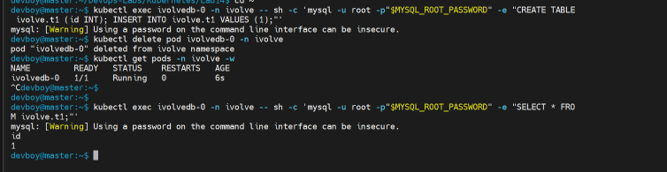

### 12. Check where the data lives on the node

On `worker-node-1`:

```bash
sudo ls /opt/local-path-provisioner
```

The provisioner stores the volume in a directory named after the PVC (`pvc-..._ivolve_data-ivolvedb-0`).

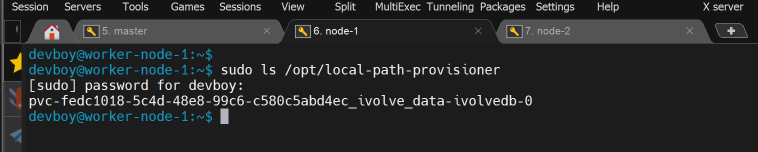

---

## Key takeaways

- A StatefulSet gives pods stable names (`ivolvedb-0`) and a dedicated PVC each, unlike a Deployment.
- A headless Service (`clusterIP: None`) provides stable per-pod DNS records instead of a single virtual IP.
- With a StorageClass and a provisioner, the PV is created on demand from the PVC template, so no PV manifest is needed.
- `nodeSelector` and `tolerations` work together to place a workload on a dedicated, tainted node.
- Credentials come from a Secret and a ConfigMap through `valueFrom`, so no password is written in the manifest.

## Cleanup

```bash
kubectl delete -f statefulset.yaml
kubectl delete -f headless-svc.yaml
kubectl delete pvc data-ivolvedb-0 -n ivolve
```

The `local-path` StorageClass reclaims (deletes) the volume when the PVC is deleted.
