# Lab 15: Node.js Application Deployment with ClusterIP Service

Deploy a Node.js application as a **Deployment** with 2 replicas in the `ivolve` namespace. The application connects to the MySQL StatefulSet from Lab 14, takes its configuration from the existing ConfigMap and Secret, runs on the dedicated node, stores its logs on the PersistentVolume from Lab 13, and is exposed inside the cluster through a **ClusterIP Service**. An **init container** prepares the database before the application starts.

## Lab requirements

| Requirement | How it is done |
|---|---|
| Deployment `ivolveApp` in `ivolve` ns with 2 replicas | `deployment.yaml` (`ivolveapp`, `replicas: 2`) |
| Use the custom Docker Hub image | `mosala7320/ivolve-node-app:1.0` |
| Consume environment variables from the existing ConfigMap and Secret | `env` with `configMapKeyRef` and `secretKeyRef` (Lab 12 objects) |
| Node selector for nodes labeled `project=ivolve` | `nodeSelector: project: ivolve` |
| Toleration with key `workload`, value `ivolveApp`, effect `NoSchedule` | `tolerations` entry in the pod spec |
| Use the PersistentVolume created in Lab 13 | Volume backed by the PVC `ivolvepvc` (bound to `ivolvepv`), mounted at `/app/logs` |
| Init container with a MySQL client image that creates the `ivolve` database and grants privileges | `init-mysql` using `mysql:8.4` |
| Pass the connection parameters to the init container from the ConfigMap and Secret | `envFrom` with the ConfigMap `ivolvecm` and the Secret `ivolvesecret` |
| ClusterIP Service `ivolveAppSvc` in `ivolve` ns | `service.yaml` (`ivolveappsvc`) |
| Connect to MySQL manually to verify the database and privileges | `mysql` client as the application user |
| Check the application logs | `kubectl logs` shows the successful MySQL connection |

> Kubernetes object names must be lowercase (RFC 1123), so `ivolveApp` and `ivolveAppSvc` are created as `ivolveapp` and `ivolveappsvc`. The toleration value stays `ivolveApp` because it must match the node taint exactly.

## Dependencies on earlier labs

| Lab | What this lab uses |
|---|---|
| Lab 10 | Node label `project=ivolve` and taint `workload=ivolveApp:NoSchedule` on `worker-node-1` |
| Lab 11 | Namespace `ivolve` and its ResourceQuota (raised to 10 pods, see step 1) |
| Lab 12 | ConfigMap `ivolvecm` (`DB_HOST`, `DB_USER`) and Secret `ivolvesecret` (`DB_PASSWORD`, `MYSQL_ROOT_PASSWORD`) |
| Lab 13 | PersistentVolume `ivolvepv` and PersistentVolumeClaim `ivolvepvc` |
| Lab 14 | MySQL StatefulSet `ivolvedb` and the headless Service `ivolvedbsvc` |

## The application image

The image is built from a small Express application that uses the `mysql2` driver. It is configured only through environment variables:

| Variable | Source in this lab | Purpose |
|---|---|---|
| `DB_HOST` | ConfigMap `ivolvecm` | MySQL host (the headless Service `ivolvedbsvc`) |
| `DB_USER` | ConfigMap `ivolvecm` | Application database user |
| `DB_PASSWORD` | Secret `ivolvesecret` | Application user password |
| `DB_NAME` | value in the manifest (`ivolve`) | Database name |
| `LOG_DIR` | value in the manifest (`/app/logs/ivolveapp`) | Directory for `app.log` on the mounted volume |

On start the application retries the MySQL connection until it succeeds, logs the connected database and user, and creates a `tasks` table if it does not exist (this proves the user has privileges on the database). It then serves `GET /` and `GET /health` (which checks the database) plus `GET /tasks` and `POST /tasks`, on port `3000`.

```dockerfile
FROM node:20-slim
WORKDIR /app
COPY package.json ./
RUN npm install --omit=dev
COPY app.js ./
ENV PORT=3000
EXPOSE 3000
CMD ["node", "app.js"]
```

```bash
docker build -t mosala7320/ivolve-node-app:1.0 .
docker push mosala7320/ivolve-node-app:1.0
```

## Files

| File | Purpose |
|---|---|
| [`deployment.yaml`](deployment.yaml) | Deployment `ivolveapp` with the init container |
| [`service.yaml`](service.yaml) | ClusterIP Service `ivolveappsvc` |
| [`screenshots/`](screenshots) | Evidence for each step |

---

## Steps

### 1. Raise the namespace quota

The ResourceQuota from Lab 11 allowed only 3 pods in `ivolve`, and the MySQL pod plus two application replicas would fill it completely, leaving no room for rolling updates or test pods. As agreed with the instructor, the quota is raised instead of removed, so it still exists and is enforced.

```bash
kubectl patch resourcequota ivolvequota -n ivolve --type merge -p '{"spec":{"hard":{"pods":"10"}}}'
kubectl describe resourcequota ivolvequota -n ivolve
```

The quota now shows `pods 1 10`.

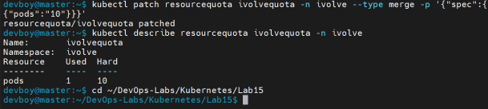

### 2. Write the Deployment manifest

[`deployment.yaml`](deployment.yaml) highlights:

- `replicas: 2` and the label `app: ivolveapp`, which the Service selects.
- `nodeSelector` and `tolerations` place the pods on the node labeled `project=ivolve`, which is tainted with `workload=ivolveApp:NoSchedule`. The selector attracts the pods and the toleration lets them past the taint.
- The **init container** `init-mysql` uses the `mysql:8.4` image, which includes the `mysql` and `mysqladmin` clients. It waits until MySQL answers, then creates the `ivolve` database, creates the application user if needed, grants it all privileges on `ivolve.*`, and exits. The statements use `IF NOT EXISTS`, so they are safe to run again on every pod start. It receives its connection parameters through `envFrom` from the ConfigMap and the Secret.
- The **application container** receives only what it needs (`DB_HOST`, `DB_USER`, `DB_PASSWORD`), so it does not get the MySQL root password.
- The `readinessProbe` calls `/health`, so a pod only receives traffic after it can reach the database.
- The volume `logs` is backed by the PVC `ivolvepvc` from Lab 13 and mounted at `/app/logs`.

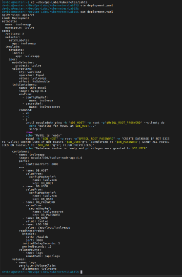

### 3. Apply the Deployment

```bash
kubectl apply -f deployment.yaml
kubectl get pods -n ivolve -w
```

Each pod goes through `PodInitializing` while the init container runs, then becomes `1/1 Running`.

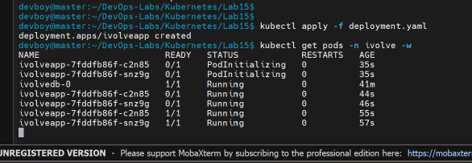

### 4. Check the init container logs

```bash
kubectl logs -n ivolve -l app=ivolveapp -c init-mysql --prefix
```

For both pods the log shows that MySQL is alive and ready, followed by `Database ivolve is ready and privileges were granted to ivolve_user`. The `[Warning] Using a password on the command line interface can be insecure` lines come from the MySQL clients and are expected in this lab.

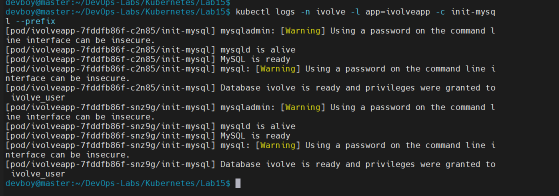

### 5. Create the ClusterIP Service

```bash
kubectl apply -f service.yaml
kubectl get svc,endpoints -n ivolve
```

The Service `ivolveappsvc` listens on port `80` and forwards to port `3000` of the pods labeled `app=ivolveapp`. The endpoints list contains the IPs of both application pods, which means both passed the readiness probe, so both can reach the database. The Service `ivolvedbsvc` from Lab 14 is listed too, with `CLUSTER-IP` set to `None` because it is headless. (The `Endpoints is deprecated` warning is only a notice; newer clusters prefer EndpointSlices.)

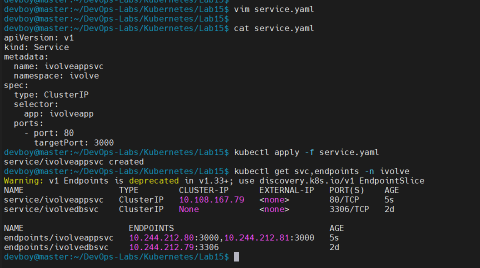

### 6. Overview of the deployed resources

```bash
kubectl get deploy,pods,svc -n ivolve -o wide
```

The Deployment is `2/2` and both application pods run on `worker-node-1`, next to the MySQL pod.

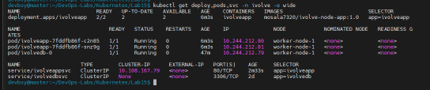

### 7. Check the pod configuration

```bash
kubectl describe pod -n ivolve -l app=ivolveapp | grep -E "Node:|Node-Selectors|Init Containers|init-mysql:|Image:|ClaimName|/app/logs"
```

The output shows the node, the `project=ivolve` selector, the init container image (`mysql:8.4`), the application image, the `LOG_DIR` variable, the `/app/logs` mount and the claim `ivolvepvc`.

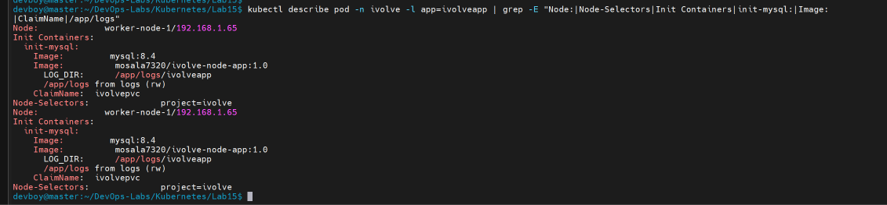

```bash
kubectl describe pod -n ivolve -l app=ivolveapp | grep -A3 "^Tolerations"
```

Next to the default tolerations that Kubernetes adds to every pod, `workload=ivolveApp:NoSchedule` is listed.

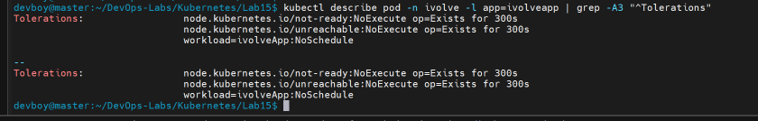

### 8. Connect to MySQL manually as the application user

```bash
kubectl exec -it ivolvedb-0 -n ivolve -- mysql -u ivolve_user -p
```

```sql
SHOW DATABASES;
SHOW GRANTS;
USE ivolve;
SHOW TABLES;
SELECT * FROM tasks;
exit
```

Connecting as `ivolve_user` shows that the `ivolve` database exists and that the user has `ALL PRIVILEGES` on `ivolve`.*. The `tasks` table was created by the application itself, which confirms the privileges work. The table `t1` in the list is left over from the persistence test in Lab 14. The `tasks` table is empty because no task has been added yet.

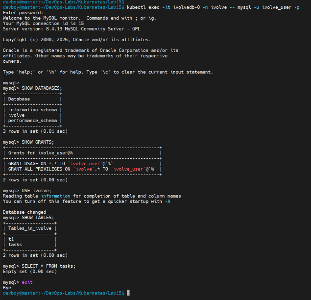

### 9. Check the application logs

```bash
kubectl logs -n ivolve -l app=ivolveapp --prefix
```

Both pods log `Connected to MySQL at ivolvedbsvc:3306. Database: ivolve, user: ivolve_user@%`, followed by `Table "tasks" is ready` and `Server listening on port 3000`. This confirms the Node.js application connects to MySQL and accesses the `ivolve` database.

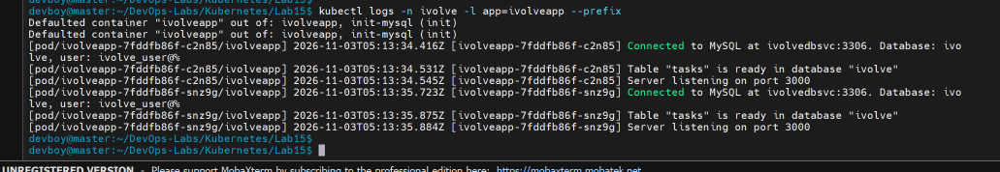

### 10. Test the Service

```bash
kubectl run curl-test --rm -it --restart=Never --image=curlimages/curl -n ivolve --command -- sh -c 'for i in 1 2 3 4 5 6; do curl -s http://ivolveappsvc/; echo; done'
```

The root endpoint returns the name of the pod that answered. The responses come from both application pods, which shows that the ClusterIP Service distributes traffic across the available pods.

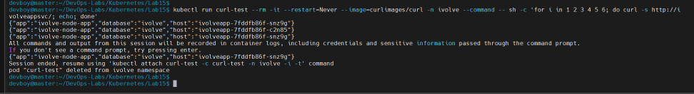

### 11. Check the logs on the PersistentVolume

On `worker-node-1`:

```bash
ls /mnt/app-logs/ivolveapp
tail -5 /mnt/app-logs/ivolveapp/app.log
```

The application writes `app.log` into the directory backed by the PersistentVolume from Lab 13, so the logs survive pod restarts.

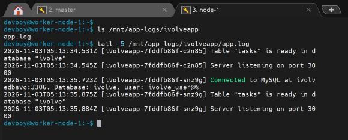

---

## Key takeaways

- An **init container** runs to completion before the application container starts, which makes it a good place to prepare dependencies such as a database.
- A **ClusterIP Service** gives a stable internal address and distributes traffic across the pods that match its selector and pass the readiness probe.
- The application receives only the variables it needs, while the init container receives the root credentials, which limits exposure of the secret values.
- `nodeSelector` and `tolerations` work together to place a workload on a dedicated, tainted node.
- A PersistentVolumeClaim lets pods write data (here, logs) that outlives the pods.

## Cleanup

```bash
kubectl delete -f service.yaml
kubectl delete -f deployment.yaml
```
