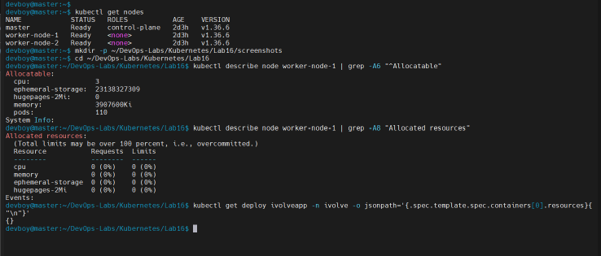
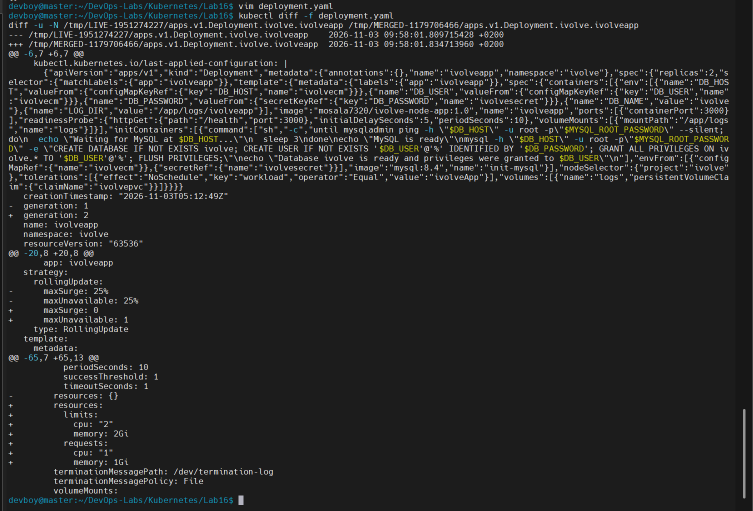
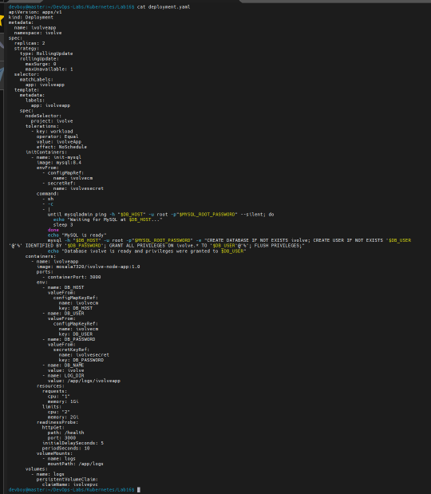
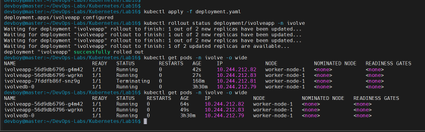
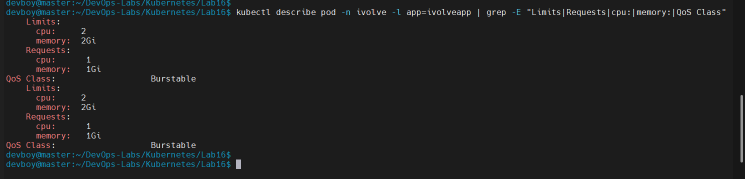
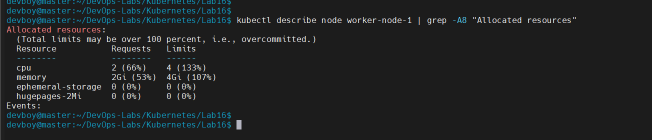
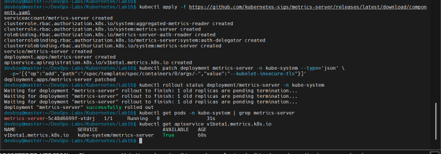
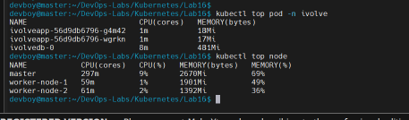

# Lab 16: Pod Resource Management with CPU and Memory Requests and Limits

Update the existing `ivolveapp` Deployment from Lab 15 so every pod declares how much CPU and memory it needs (**requests**) and the most it may use (**limits**), then verify the settings and watch the real resource usage with `kubectl top`.

## Lab requirements

| Requirement | How it is done |
|---|---|
| Update the existing `ivolveApp` Deployment with resource requests and limits | `deployment.yaml` applied over the Lab 15 Deployment |
| Requests: `cpu: 1`, `memory: 1Gi` | `resources.requests` on the `ivolveapp` container |
| Limits: `cpu: 2`, `memory: 2Gi` | `resources.limits` on the `ivolveapp` container |
| Verify the applied requests and limits with `kubectl describe pod` | `kubectl describe pod` output |
| Monitor real-time usage with `kubectl top pod` (the metrics server must be running) | metrics-server installed, then `kubectl top` |

## Requests and limits

| | Meaning | What happens when it is exceeded |
|---|---|---|
| **Request** | The amount the scheduler reserves for the pod. A pod is only placed on a node that still has this much unreserved. | Not applicable: it is a guarantee, not a ceiling. |
| **Limit** | The maximum the container may use. | CPU is throttled. Memory above the limit gets the container killed (`OOMKilled`). |

Because the requests are lower than the limits, Kubernetes assigns the pods the **Burstable** QoS class.

## Dependencies on earlier labs

| Lab | What this lab uses |
|---|---|
| Lab 10 | Only `worker-node-1` (label `project=ivolve`) accepts the application pods, so its capacity matters |
| Lab 11 | The `ivolve` namespace and its ResourceQuota (raised to 10 pods in Lab 15) |
| Lab 15 | The `ivolveapp` Deployment that is updated here |

## Files

| File | Purpose |
|---|---|
| [`deployment.yaml`](deployment.yaml) | The Lab 15 Deployment with `resources` and an explicit rolling update `strategy` |
| [`screenshots/`](screenshots) | Evidence for each step |

---

## Steps

### 1. Check that the node can hold the new requests

The application pods can only run on `worker-node-1`, and two pods will now reserve 2 CPUs and 2Gi in total.

```bash
kubectl describe node worker-node-1 | grep -A6 "^Allocatable"
kubectl describe node worker-node-1 | grep -A8 "Allocated resources"
kubectl get deploy ivolveapp -n ivolve -o jsonpath='{.spec.template.spec.containers[0].resources}{"\n"}'
```

The node has 3 allocatable CPUs and about 3.7Gi of allocatable memory, nothing is reserved yet, and the Deployment currently has no resources set (`{}`).



### 2. Update the Deployment manifest

[`deployment.yaml`](deployment.yaml) is the Lab 15 manifest with two additions:

- `resources` on the `ivolveapp` container: requests `cpu: "1"` and `memory: 1Gi`, limits `cpu: "2"` and `memory: 2Gi`.
- An explicit rolling update strategy with `maxSurge: 0` and `maxUnavailable: 1`. Changing the resources triggers a rolling update. By default Kubernetes starts an extra pod before removing an old one, which here would need a third pod with a 1 CPU request on a node that has exactly 3 allocatable CPUs, leaving no headroom. With `maxSurge: 0` the old pods are replaced one at a time instead.

Preview the change before applying it:

```bash
kubectl diff -f deployment.yaml
```

The diff shows `resources: {}` replaced by the new requests and limits, and the strategy changing from `25%` to `maxSurge: 0` and `maxUnavailable: 1`.





### 3. Apply the update and follow the rollout

```bash
kubectl apply -f deployment.yaml
kubectl rollout status deployment/ivolveapp -n ivolve
kubectl get pods -n ivolve -o wide
```

The Deployment is rolled out one pod at a time (the old pod is `Terminating` while the new ones come up) and ends with `deployment "ivolveapp" successfully rolled out`. The two new pods run on `worker-node-1` and the MySQL pod `ivolvedb-0` is untouched.



### 4. Verify the requests and limits on the pods

```bash
kubectl describe pod -n ivolve -l app=ivolveapp | grep -E "Limits|Requests|cpu:|memory:|QoS Class"
```

Both pods show limits of `cpu: 2` and `memory: 2Gi`, requests of `cpu: 1` and `memory: 1Gi`, and the QoS class `Burstable`.



### 5. See how the scheduler accounts for them

```bash
kubectl describe node worker-node-1 | grep -A8 "Allocated resources"
```

The node now has 2 CPUs (66%) and 2Gi of memory (53%) reserved, which is the sum of the two pods' **requests**. The limits add up to 4 CPUs (133%) and 4Gi (107%). Limits may exceed the node's capacity (the output notes that limits can be overcommitted), while requests cannot, because requests are what the scheduler reserves.



### 6. Install the metrics server

`kubectl top` needs the Metrics API, which kubeadm clusters do not include. The metrics server collects CPU and memory usage from the kubelets and serves it through that API.

```bash
kubectl apply -f https://github.com/kubernetes-sigs/metrics-server/releases/latest/download/components.yaml

kubectl patch deployment metrics-server -n kube-system --type='json' \
  -p='[{"op":"add","path":"/spec/template/spec/containers/0/args/-","value":"--kubelet-insecure-tls"}]'

kubectl rollout status deployment/metrics-server -n kube-system
kubectl get pods -n kube-system | grep metrics-server
kubectl get apiservice v1beta1.metrics.k8s.io
```

The `--kubelet-insecure-tls` flag is needed because the kubelets of a kubeadm cluster use self-signed serving certificates. That is acceptable in this lab environment, while a production cluster should use properly signed kubelet certificates instead. The metrics server pod is `Running` and the `v1beta1.metrics.k8s.io` API service reports `Available: True`.



### 7. Monitor the real resource usage

```bash
kubectl top pod -n ivolve
kubectl top node
```



The application pods use about `1m` of CPU and `17Mi` to `18Mi` of memory, while the MySQL pod uses about `8m` and `481Mi`. The nodes show their overall CPU and memory usage as well.

---

## Key takeaways

- **Requests** decide where a pod can be scheduled and what it is guaranteed. **Limits** protect the node and the other pods from a single container using too much.
- The actual usage (about `1m` CPU and under `20Mi` per application pod) is far below the `1` CPU and `1Gi` that each pod reserves. Requests are reservations, not measurements, so in a real project they should be sized from observed usage with `kubectl top` or monitoring instead of guessed.
- Reserving 1 CPU per pod on a node with 3 CPUs leaves little room for more pods, so oversized requests directly reduce how many pods fit on a node.
- A rolling update can need temporary extra capacity. When a node has no headroom, `maxSurge: 0` lets the update proceed by replacing pods one at a time.
- `kubectl top` depends on the metrics server, which is also what the Horizontal Pod Autoscaler uses.

## Cleanup

To go back to the Lab 15 settings, apply the Lab 15 `deployment.yaml` again. To remove the metrics server:

```bash
kubectl delete -f https://github.com/kubernetes-sigs/metrics-server/releases/latest/download/components.yaml
```
