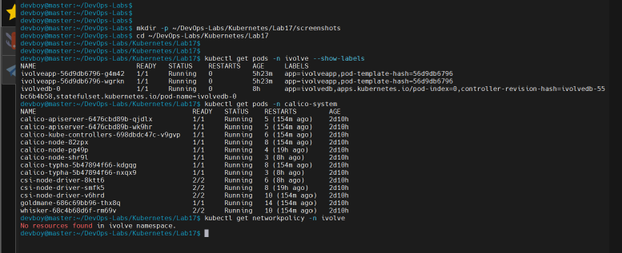
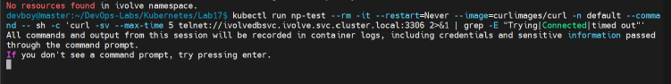
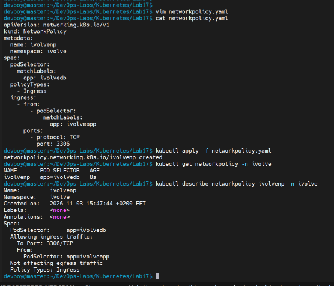
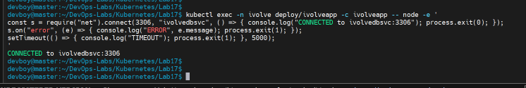
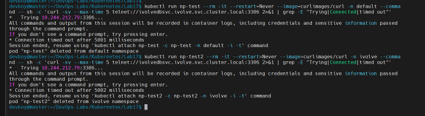
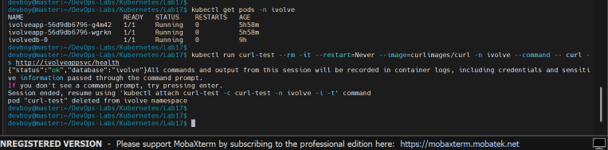

# Lab 17: Control Pod-to-Pod Traffic via Network Policy

Restrict access to the MySQL pod with a **NetworkPolicy**, so that only the application pods can reach it, and only on the MySQL port (3306).

## Lab requirements

| Requirement | How it is done |
|---|---|
| Name: `ivolveNP` | `ivolvenp` (Kubernetes object names must be lowercase) |
| Pod selector: targets the MySQL pod | `podSelector` with `app: ivolvedb`, the label of the StatefulSet pod from Lab 14 |
| Policy types: only Ingress | `policyTypes: [Ingress]` |
| Ingress rule: allow traffic only from the application pods | `from` with a `podSelector` for `app: ivolveapp`, the label of the Deployment pods from Lab 15 |
| Ingress rule: restrict access to port 3306 | `ports` with `TCP` `3306` |

## What a NetworkPolicy does

By default every pod in a Kubernetes cluster can talk to every other pod. A NetworkPolicy works as a firewall at the pod level: as soon as a pod is selected by a policy that has the `Ingress` type, all incoming traffic to it is denied except what the policy explicitly allows. Policies are only enforced if the network plugin supports them. This cluster uses **Calico** (installed in Lab 9), which enforces them, while Flannel would silently ignore them.

## Dependencies on earlier labs

| Lab | What this lab uses |
|---|---|
| Lab 9 | Calico, which enforces the policy |
| Lab 14 | The MySQL pod (label `app=ivolvedb`) and the headless Service `ivolvedbsvc` |
| Lab 15 | The application pods (label `app=ivolveapp`) and the Service `ivolveappsvc` |

## Files

| File | Purpose |
|---|---|
| [`networkpolicy.yaml`](networkpolicy.yaml) | The NetworkPolicy `ivolvenp` |
| [`screenshots/`](screenshots) | Evidence for each step |

---

## Steps

### 1. Check the pod labels and the network plugin

The policy selects pods by their labels, so first confirm them, and check that Calico is running and that no policy exists yet.

```bash
kubectl get pods -n ivolve --show-labels
kubectl get pods -n calico-system
kubectl get networkpolicy -n ivolve
```

The application pods carry `app=ivolveapp`, the MySQL pod carries `app=ivolvedb`, the Calico pods are running, and the namespace has no NetworkPolicy yet (`No resources found`).



### 2. Test the access before the policy

A temporary pod is started in the `default` namespace, so it is a pod that has nothing to do with the application, and it tries to open a TCP connection to the MySQL Service on port 3306:

```bash
kubectl run np-test --rm -it --restart=Never --image=curlimages/curl -n default --command -- sh -c 'curl -sv --max-time 5 telnet://ivolvedbsvc.ivolve.svc.cluster.local:3306 2>&1 | grep -E "Trying|Connected|timed out"'
```

Without a policy the connection succeeds (`Connected to ...:3306`), so any pod in the cluster can reach the database. This is the exposure the policy removes. (The `Connected` line is what matters. A `timed out` line can still appear afterwards because `curl` waits for a reply that never comes from a non-HTTP service.)



### 3. Create the NetworkPolicy

[`networkpolicy.yaml`](networkpolicy.yaml):

```yaml
apiVersion: networking.k8s.io/v1
kind: NetworkPolicy
metadata:
  name: ivolvenp
  namespace: ivolve
spec:
  podSelector:
    matchLabels:
      app: ivolvedb
  policyTypes:
    - Ingress
  ingress:
    - from:
        - podSelector:
            matchLabels:
              app: ivolveapp
      ports:
        - protocol: TCP
          port: 3306
```

- `spec.podSelector` chooses the pods the policy protects: the MySQL pod.
- `policyTypes: [Ingress]` makes the policy about incoming traffic only. Outgoing traffic is not affected.
- The `from` entry uses only a `podSelector`, without a `namespaceSelector`, so it means pods with the label `app=ivolveapp` **in the same namespace** (`ivolve`). Pods from other namespaces are not allowed.
- `ports` limits the allowed traffic to TCP port 3306.

### 4. Apply the policy and inspect it

```bash
kubectl apply -f networkpolicy.yaml
kubectl get networkpolicy -n ivolve
kubectl describe networkpolicy ivolvenp -n ivolve
```

`describe` shows the policy in readable form: the selected pods (`app=ivolvedb`), the allowed ingress (`3306/TCP` from pods with `app=ivolveapp`), that egress traffic is not affected, and the policy type `Ingress`.



### 5. The application can still reach MySQL

A new TCP connection is opened to MySQL from inside an application pod:

```bash
kubectl exec -n ivolve deploy/ivolveapp -c ivolveapp -- node -e '
const s = require("net").connect(3306, "ivolvedbsvc", () => { console.log("CONNECTED to ivolvedbsvc:3306"); process.exit(0); });
s.on("error", (e) => { console.log("ERROR", e.message); process.exit(1); });
setTimeout(() => { console.log("TIMEOUT"); process.exit(1); }, 5000);
'
```

The output is `CONNECTED to ivolvedbsvc:3306`: the pod has the label `app=ivolveapp`, so the policy allows it.



### 6. Every other pod is blocked

The same test as in step 2, from two pods that are not part of the application: one in the `default` namespace and one in the `ivolve` namespace itself (without the application label).

```bash
kubectl run np-test --rm -it --restart=Never --image=curlimages/curl -n default --command -- sh -c 'curl -sv --max-time 5 telnet://ivolvedbsvc.ivolve.svc.cluster.local:3306 2>&1 | grep -E "Trying|Connected|timed out"'

kubectl run np-test2 --rm -it --restart=Never --image=curlimages/curl -n ivolve --command -- sh -c 'curl -sv --max-time 5 telnet://ivolvedbsvc.ivolve.svc.cluster.local:3306 2>&1 | grep -E "Trying|Connected|timed out"'
```

Both attempts end with `Connection timed out after 5001 milliseconds` and never print `Connected`, unlike step 2. The packets are dropped, so a pod from another namespace and even a pod from the same namespace without the application label cannot reach the database.



### 7. The application keeps working

```bash
kubectl get pods -n ivolve
kubectl run curl-test --rm -it --restart=Never --image=curlimages/curl -n ivolve --command -- curl -s http://ivolveappsvc/health
```

The pods stay `Running` and the health endpoint of the application, which queries the database, answers `{"status":"ok","database":"ivolve"}`. Together with step 5, this shows that the policy blocks only the traffic that should be blocked.



---

## Key takeaways

- Kubernetes allows all pod-to-pod traffic by default. A NetworkPolicy is how that is narrowed down to what is really needed (least privilege).
- A pod that is selected by an `Ingress` policy denies everything that is not explicitly allowed.
- A `podSelector` in a `from` rule without a `namespaceSelector` only matches pods in the policy's own namespace.
- Policies are enforced by the network plugin, so the plugin has to support them (Calico does, Flannel does not).
- If the application pod is compromised it can still reach the database, but no other workload can, which limits the damage a single compromised pod can do.

## Cleanup

```bash
kubectl delete -f networkpolicy.yaml
```
