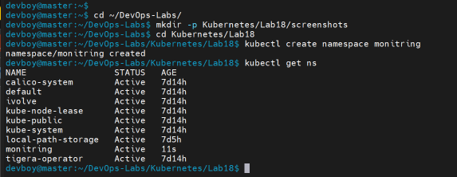
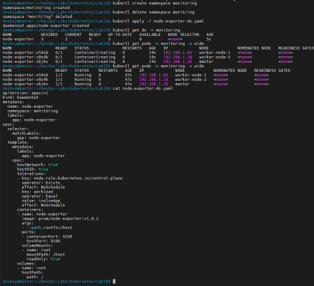
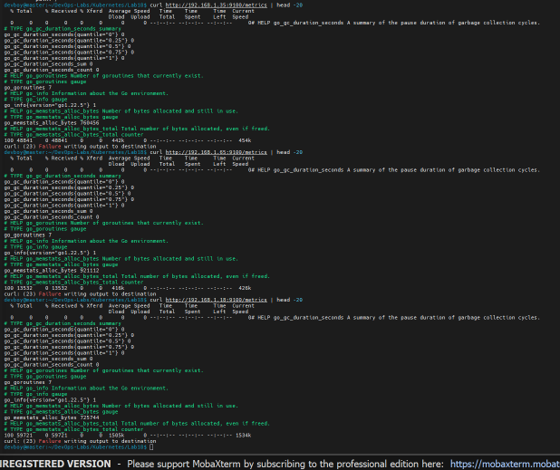
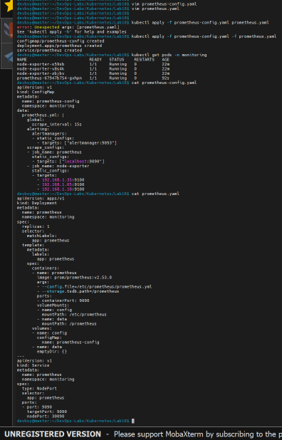
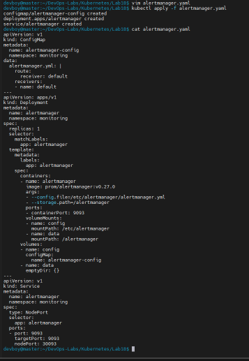
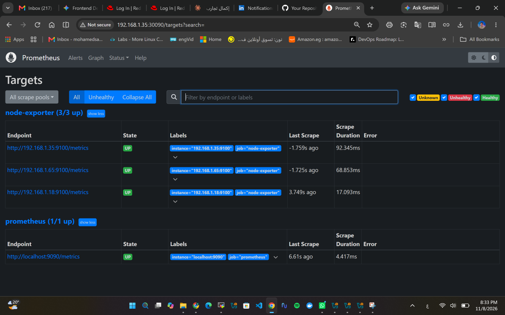
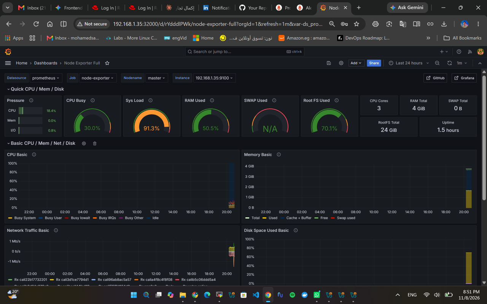

# Lab 18: Node-Wide Pod Management with DaemonSet

## Objective

Deploy a monitoring stack in a dedicated `monitoring` namespace and use a **DaemonSet** to run Prometheus **node-exporter** on every node of the cluster:

- Create the `monitoring` namespace
- Deploy Prometheus, Alertmanager and Grafana
- Deploy node-exporter as a DaemonSet
- Validate that one node-exporter pod runs on each node
- Confirm the metrics are exposed at `<node_IP>:9100/metrics`
- Configure Prometheus to scrape node-exporter
- Configure a Grafana dashboard for Kubernetes

## Environment

| Node | Role | IP |
|------|------|----|
| master | control-plane | 192.168.1.35 |
| worker-node-1 | worker | 192.168.1.65 |
| worker-node-2 | worker | 192.168.1.18 |

Cluster built with kubeadm (containerd + Calico).

## Files

| File | Description |
|------|-------------|
| `node-exporter-ds.yaml` | node-exporter DaemonSet |
| `prometheus-config.yaml` | Prometheus ConfigMap (scrape and alerting config) |
| `prometheus.yaml` | Prometheus Deployment and NodePort Service |
| `alertmanager.yaml` | Alertmanager ConfigMap, Deployment and NodePort Service |
| `grafana.yaml` | Grafana Deployment and NodePort Service |

## Steps

### 1. Create the namespace

```bash
kubectl create namespace monitoring
kubectl get ns
```



### 2. Deploy node-exporter as a DaemonSet

```bash
kubectl apply -f node-exporter-ds.yaml
kubectl get ds -n monitoring
kubectl get pods -n monitoring -o wide
```

Key points in the manifest:

- `hostNetwork: true` and `hostPort: 9100` so the metrics are reachable on each node IP.
- `hostPID: true` and a read-only `hostPath` mount of `/` so the exporter can read host metrics.
- **Tolerations** for the control-plane taint and for the `workload=ivolveApp:NoSchedule` taint on worker-node-1, so a pod is scheduled on every node.

The DaemonSet shows 3/3 and one pod is running on each node (master, worker-node-1, worker-node-2).



### 3. Verify the metrics endpoint

```bash
curl -s http://192.168.1.35:9100/metrics | head -20
curl -s http://192.168.1.65:9100/metrics | head -20
curl -s http://192.168.1.18:9100/metrics | head -20
```



### 4. Deploy Prometheus

The ConfigMap defines the scrape jobs (Prometheus itself and the three node-exporter targets) and points to Alertmanager.

```bash
kubectl apply -f prometheus-config.yaml -f prometheus.yaml
kubectl get pods -n monitoring
```

Prometheus is exposed on NodePort `30090`.



### 5. Deploy Alertmanager and Grafana

```bash
kubectl apply -f alertmanager.yaml
kubectl apply -f grafana.yaml
kubectl get pods,svc -n monitoring
```

| Service | NodePort |
|---------|----------|
| Prometheus | 30090 |
| Alertmanager | 30093 |
| Grafana | 32000 |



### 6. Confirm Prometheus is collecting from node-exporter

Open `http://192.168.1.35:30090/targets`. All three `node-exporter` targets are **UP**.



### 7. Configure the Grafana dashboard

1. Open `http://192.168.1.35:32000` and log in (`admin` / `admin`, then set a new password).
2. **Connections → Data sources → Add data source → Prometheus**, set the URL to `http://prometheus:9090`, then **Save & test**.
3. **Dashboards → New → Import**, enter ID `1860` (Node Exporter Full), select the Prometheus data source, and import.

The dashboard shows CPU, memory, disk and network metrics for the nodes.



## Notes

- Without the tolerations, the node-exporter pods would not be scheduled on the master or on worker-node-1 because of their taints.
- Prometheus, Alertmanager and Grafana use `emptyDir` volumes, so their data is lost if the pods are recreated. A PVC can be used for persistence.
- Prometheus scrapes the nodes through static targets. In a larger cluster, Kubernetes service discovery would be a better fit.

