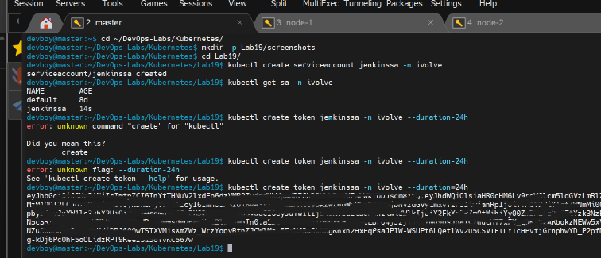
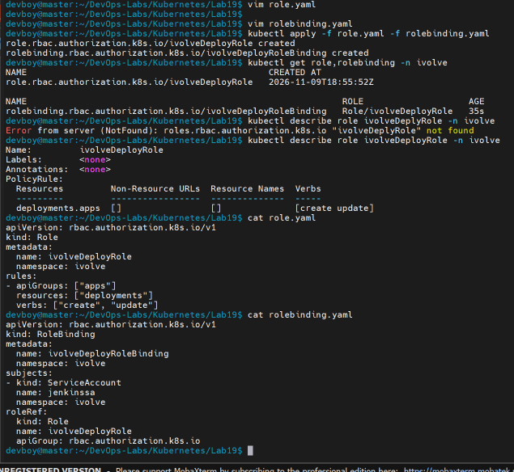
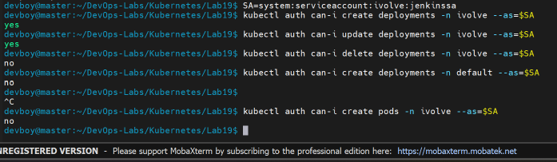
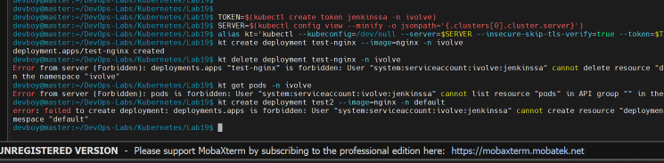

# Lab 19: Securing Kubernetes with RBAC and Service Accounts

## Objective

Give a CI tool (Jenkins) the minimum permissions it needs, following the principle of **least privilege**:

- Create the `jenkinssa` Service Account in the `ivolve` namespace
- Create a token for the Service Account
- Define a Role named `ivolveDeployRole` that allows **create** and **update** on Deployments in `ivolve`
- Bind the Role to the Service Account with a RoleBinding named `ivolveDeployRoleBinding`
- Validate that the Service Account can only create and update Deployments in `ivolve`

> **Note:** Kubernetes requires Service Account names to be lowercase, so `jenkinsSA` from the lab sheet is created as `jenkinssa`.

## Files

| File | Description |
|------|-------------|
| `role.yaml` | Role `ivolveDeployRole` (create/update on deployments) |
| `rolebinding.yaml` | RoleBinding `ivolveDeployRoleBinding` linking the Role to `jenkinssa` |

## Steps

### 1. Create the Service Account and a token

```bash
kubectl create serviceaccount jenkinssa -n ivolve
kubectl get sa -n ivolve
kubectl create token jenkinssa -n ivolve --duration=24h
```

The token is what Jenkins would send to the API server to authenticate as `jenkinssa`. It expires after the given duration. The token value is hidden in the screenshot on purpose.



### 2. Create the Role

`role.yaml`:

```yaml
apiVersion: rbac.authorization.k8s.io/v1
kind: Role
metadata:
  name: ivolveDeployRole
  namespace: ivolve
rules:
- apiGroups: ["apps"]
  resources: ["deployments"]
  verbs: ["create", "update"]
```

Deployments belong to the `apps` API group, which is why `apiGroups` is `["apps"]`. A Role only defines permissions, it does not grant them to anyone yet.

### 3. Create the RoleBinding

`rolebinding.yaml`:

```yaml
apiVersion: rbac.authorization.k8s.io/v1
kind: RoleBinding
metadata:
  name: ivolveDeployRoleBinding
  namespace: ivolve
subjects:
- kind: ServiceAccount
  name: jenkinssa
  namespace: ivolve
roleRef:
  kind: Role
  name: ivolveDeployRole
  apiGroup: rbac.authorization.k8s.io
```

```bash
kubectl apply -f role.yaml -f rolebinding.yaml
kubectl get role,rolebinding -n ivolve
kubectl describe role ivolveDeployRole -n ivolve
```



### 4. Validate with `kubectl auth can-i`

```bash
SA=system:serviceaccount:ivolve:jenkinssa

kubectl auth can-i create deployments -n ivolve --as=$SA    # yes
kubectl auth can-i update deployments -n ivolve --as=$SA    # yes
kubectl auth can-i delete deployments -n ivolve --as=$SA    # no
kubectl auth can-i create deployments -n default --as=$SA   # no
kubectl auth can-i create pods -n ivolve --as=$SA           # no
```



### 5. Validate with the token

Passing `--token` alone is not enough here: the admin kubeconfig on the master contains a client certificate, which the API server checks first, so the commands would run as admin. To test as the Service Account, the kubeconfig is ignored:

```bash
TOKEN=$(kubectl create token jenkinssa -n ivolve)
SERVER=$(kubectl config view --minify -o jsonpath='{.clusters[0].cluster.server}')
alias kt='kubectl --kubeconfig=/dev/null --server=$SERVER --insecure-skip-tls-verify=true --token=$TOKEN'

kt create deployment test-nginx --image=nginx -n ivolve    # allowed
kt delete deployment test-nginx -n ivolve                  # Forbidden
kt get pods -n ivolve                                      # Forbidden
kt create deployment test2 --image=nginx -n default        # Forbidden
```

The Forbidden errors show the user `system:serviceaccount:ivolve:jenkinssa`, which confirms the requests were made with the Service Account identity. After the test, the test Deployment was removed with the admin account:

```bash
kubectl delete deployment test-nginx -n ivolve
```



## Result

| Action | Result |
|--------|--------|
| Create Deployment in `ivolve` | Allowed |
| Update Deployment in `ivolve` | Allowed |
| Delete Deployment in `ivolve` | Forbidden |
| List Pods in `ivolve` | Forbidden |
| Create Deployment in `default` | Forbidden |

## Notes

- A **Role** is limited to one namespace. A ClusterRole would apply cluster-wide.
- A Role has no effect until a **RoleBinding** attaches it to a subject.
- Tokens should be treated like passwords and never committed to Git.

