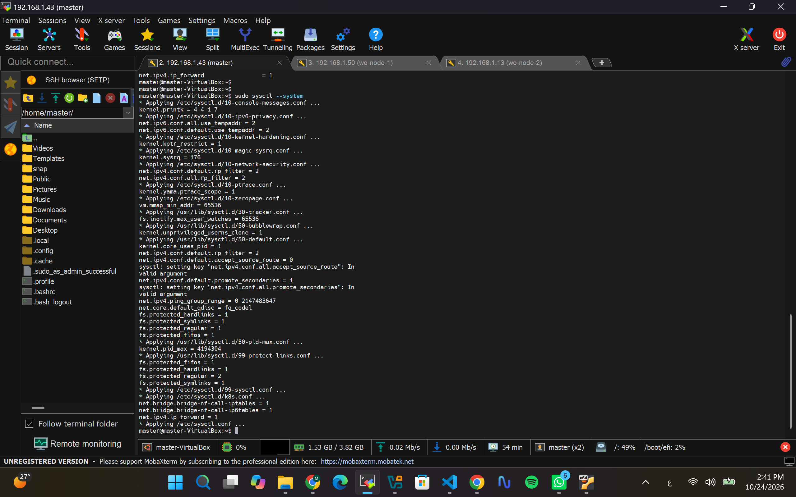
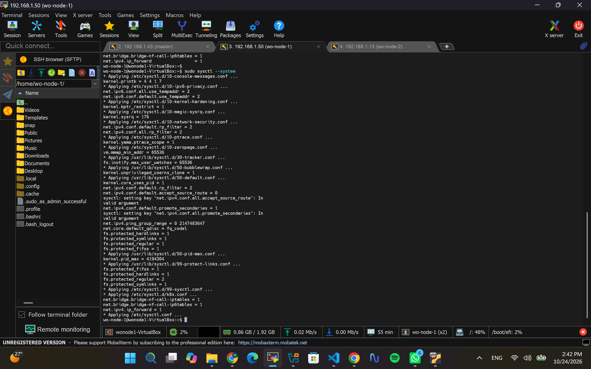
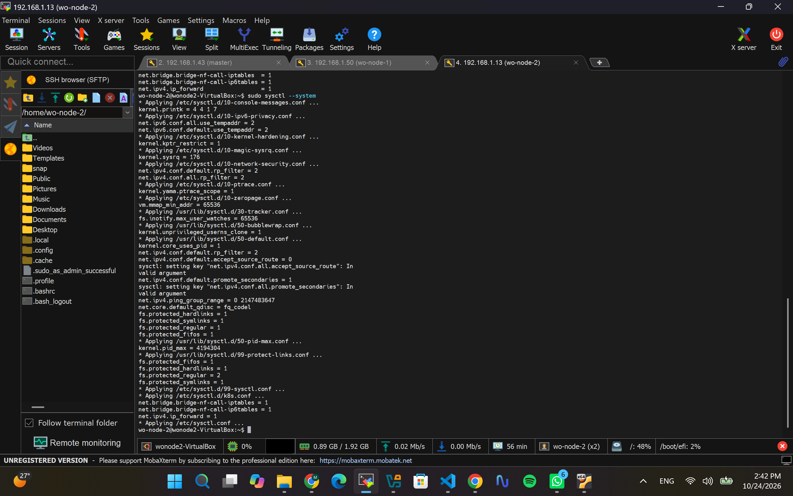
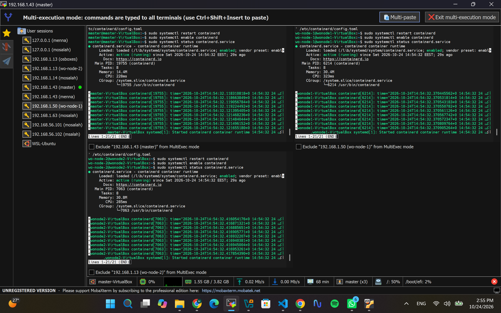
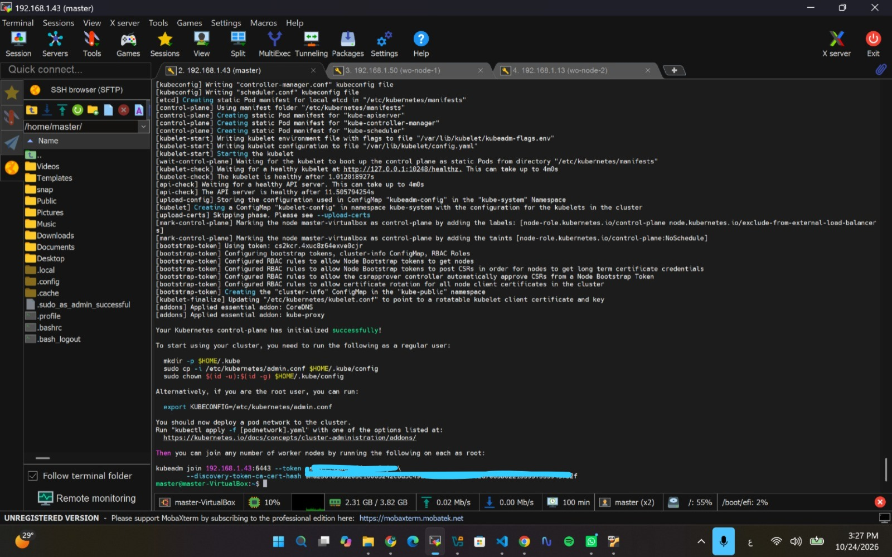
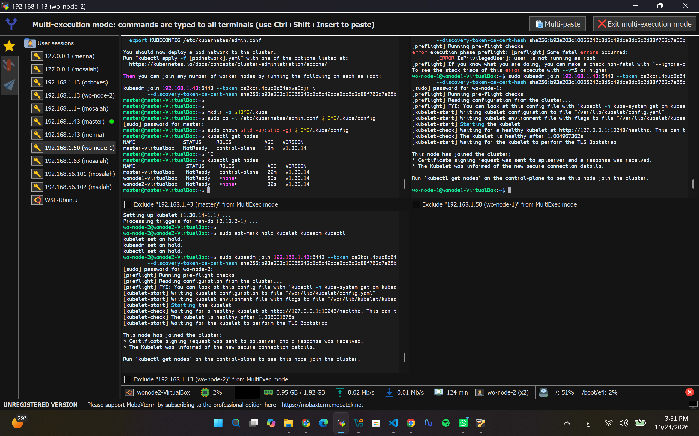
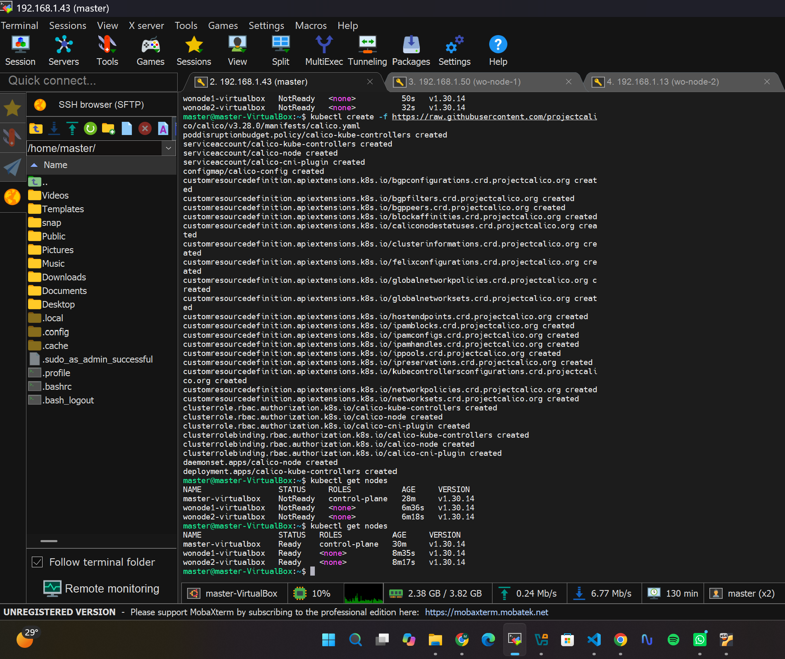
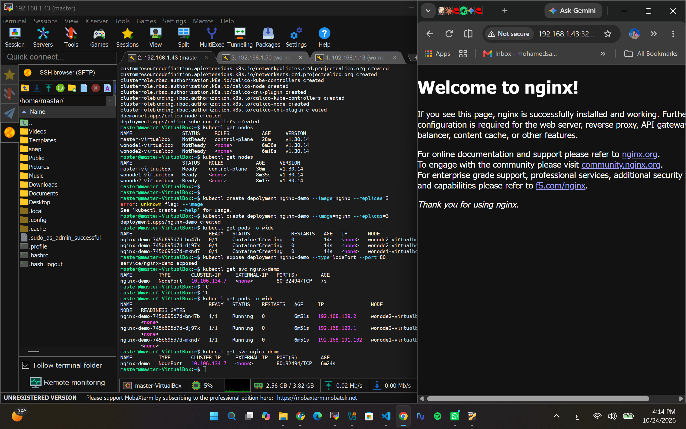
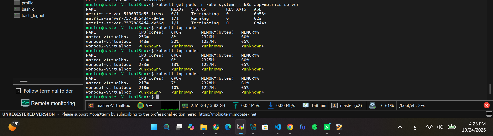
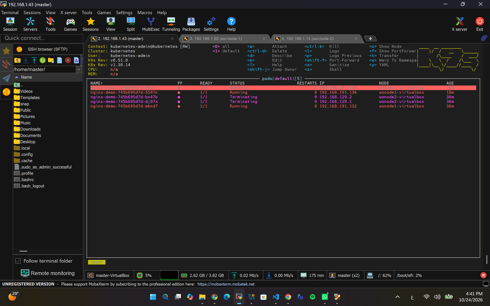

# 🚀 Building a Production-Ready 3-Node Kubernetes Cluster from Scratch

Welcome to my DevOps lab documentation! In this project, I successfully provisioned, configured, and managed a fully functional **3-node Kubernetes cluster** (1 Master and 2 Worker nodes) on Ubuntu Virtual Machines. We deployed core networking, workloads, monitoring tools, and high-performance cluster management interfaces.

---

## 🏗️ Architecture & Environment Stack
- **Virtualization:** Oracle VirtualBox (3 Ubuntu VMs: 1 Master, 2 Workers)
- **Networking:** Bridged Networking + Calico CNI
- **Container Runtime:** `containerd`
- **Orchestration:** Kubernetes v1.30 (`kubeadm`, `kubelet`, `kubectl`)
- **Monitoring & Management:** Metrics Server & K9s CLI

---

## 📸 Lab Step-by-Step Implementation & Documentation

### Step 1: Infrastructure Provisioning & Virtual Machines Setup
We started by create-3-VMs-master-and-2-worker-nodes.png)

### Step 2: System Configuration & Kernel Parameters (`sysctl`)
Configured necessary kernel modules (`br_netfilter`) and system network parameters to allow iptables to transparently see bridged traffic across Master and Worker nodes.
- **Master Node Configuration:**
  
- **Worker Node 1 Configuration:**
  
- **Worker Node 2 Configuration:**
  

### Step 3: Container Runtime (`containerd`) & Kubernetes Tools Installation
Installed `containerd` as our enterprise container runtime, configured its cgroups driver, and installed the core Kubernetes toolset (`kubeadm`, `kubelet`, `kubectl`) version 1.30.
- **Containerd Installation:**
  
- **Kubernetes Tools Installation:**
  

### Step 4: Cluster Initialization (`kubeadm init`) & Worker Nodes Joining
Initialized the control plane on the Master node using `kubeadm init`, copied the admin cluster configuration, and securely joined both worker nodes to the cluster.
- **Kubeadm Init Success:**
  
- **Workers Joined Successfully:**
  

### Step 5: Cluster Health & Readiness Verification
Verified that all cluster nodes transitioned into the `Ready` state with Calico CNI fully operational for pod-to-pod networking.
- **Cluster Ready Status:**
  

### Step 6: Deploying Sample Application (Nginx Workload)
Deployed an Nginx workload structured with replicas and exposed it via `NodePort` to test intra-cluster load balancing and external connectivity.
- **Nginx Application Deployment:**
  

### Step 7: Resource Monitoring with Metrics Server
Installed the Kubernetes Metrics Server, patched it to bypass insecure TLS with kubelets (`--kubelet-insecure-tls`), and validated real-time resource tracking (`kubectl top nodes`).
- **Metrics Server Validation:**
  

---

## 🏆 Final Result & High-Performance Management (K9s CLI)
To achieve ultimate cluster observability and overcome traditional dashboard proxy limitations, we integrated **K9s CLI** as our primary high-performance monitoring interface, providing live tracking of pods, nodes, and resource usage.
- **K9s CLI**
  

---

## 👤 Author
**Mohamed Salah**
