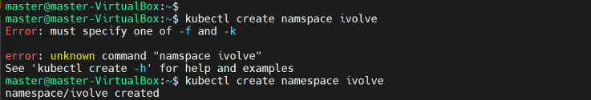
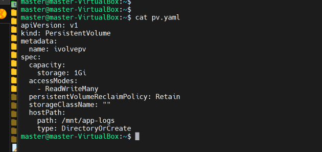
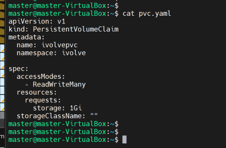
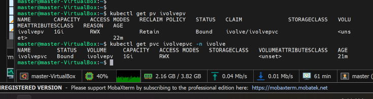

# Lab 13: Static Persistent Storage Provisioning in Kubernetes

This repository details the implementation of static persistent storage provisioning within a self-managed, production-grade 3-node Kubernetes cluster. The objective of this lab is to configure local host storage (`hostPath`), define a static binding policy using a custom namespace, and enforce data persistence across the application lifecycle.

---

## 📌 Architecture & Prerequisites

### Infrastructure Topology
* **Cluster Management**: `kubeadm`
* **Nodes**: 1 Control Plane (`master-virtualbox`), 2 Worker Nodes (`wonode1-virtualbox`, `wonode2-virtualbox`)
* **OS**: Ubuntu 22.04 LTS
* **Container Runtime**: `containerd`
* **Container Network Interface (CNI)**: Calico
* **Kubernetes Version**: `v1.30.14`

### Storage Strategy
* **Provisioning Type**: Static Provisioning (`storageClassName: ""`)
* **Volume Type**: `hostPath` (`/mnt/app-logs`)
* **Reclaim Policy**: `Retain`
* **Access Mode**: `ReadWriteMany` (`RWX`)
* **Target Namespace**: `ivolve`

---

## 📂 Repository Structure

```text
lab13/
├── README.md
├── pv.yaml
├── pvc.yaml
└── screenshots/
    ├── create-namespace.png
    ├── pv.yaml-file.png
    ├── pvc.yaml-file.png
    └── verification-success.png
```

---

## 🛠️ Step-by-Step Implementation Guide

### Step 1: Create Dedicated Namespace
Isolate the lab resources by creating a dedicated namespace named `ivolve`:

```bash
kubectl create namespace ivolve
```



---

### Step 2: Define and Deploy PersistentVolume (PV)
Configure a cluster-scoped `PersistentVolume` pointing to `/mnt/app-logs` on the host node.

**`pv.yaml`**:
```yaml
apiVersion: v1
kind: PersistentVolume
metadata:
  name: ivolvepv
spec:
  capacity:
    storage: 1Gi
  accessModes:
    - ReadWriteMany
  persistentVolumeReclaimPolicy: Retain
  storageClassName: ""
  hostPath:
    path: /mnt/app-logs
    type: DirectoryOrCreate
```

Apply the manifest:
```bash
kubectl apply -f pv.yaml
```



---

### Step 3: Define and Deploy PersistentVolumeClaim (PVC)
Create a namespace-scoped `PersistentVolumeClaim` to request storage from the pre-provisioned PV.

**`pvc.yaml`**:
```yaml
apiVersion: v1
kind: PersistentVolumeClaim
metadata:
  name: ivolvepvc
  namespace: ivolve
spec:
  accessModes:
    - ReadWriteMany
  resources:
    requests:
      storage: 1Gi
  storageClassName: ""
```

Apply the manifest inside the `ivolve` namespace:
```bash
kubectl apply -f pvc.yaml -n ivolve
```



---

### Step 4: Verification of Static Binding
Verify that the `PersistentVolumeClaim` successfully discovers and binds to `ivolvepv`.

```bash
# Verify Persistent Volume
kubectl get pv ivolvepv

# Verify Persistent Volume Claim
kubectl get pvc ivolvepvc -n ivolve
```

**Output Confirmation**:
* **PV Status**: `Bound`
* **PVC Claim**: `ivolve/ivolvepvc`
* **Access Mode**: `RWX`



---

## 🔧 Operational Troubleshooting Log

During the cluster lifecycle and node reboots, the following recovery workflow was established for service health issues (such as `kubelet` API `Connection Refused` or `containerd` socket failures):

1. **Disable Active Swap**:
   ```bash
   sudo swapoff -a
   ```
2. **Restart Container Runtime Engine**:
   ```bash
   sudo systemctl restart containerd
   ```
3. **Restart Kubernetes Node Agent**:
   ```bash
   sudo systemctl restart kubelet
   ```
4. **Confirm Cluster Node Status**:
   ```bash
   kubectl get nodes
   ```

---

## 👤 Author
Mohamed SAlah 
