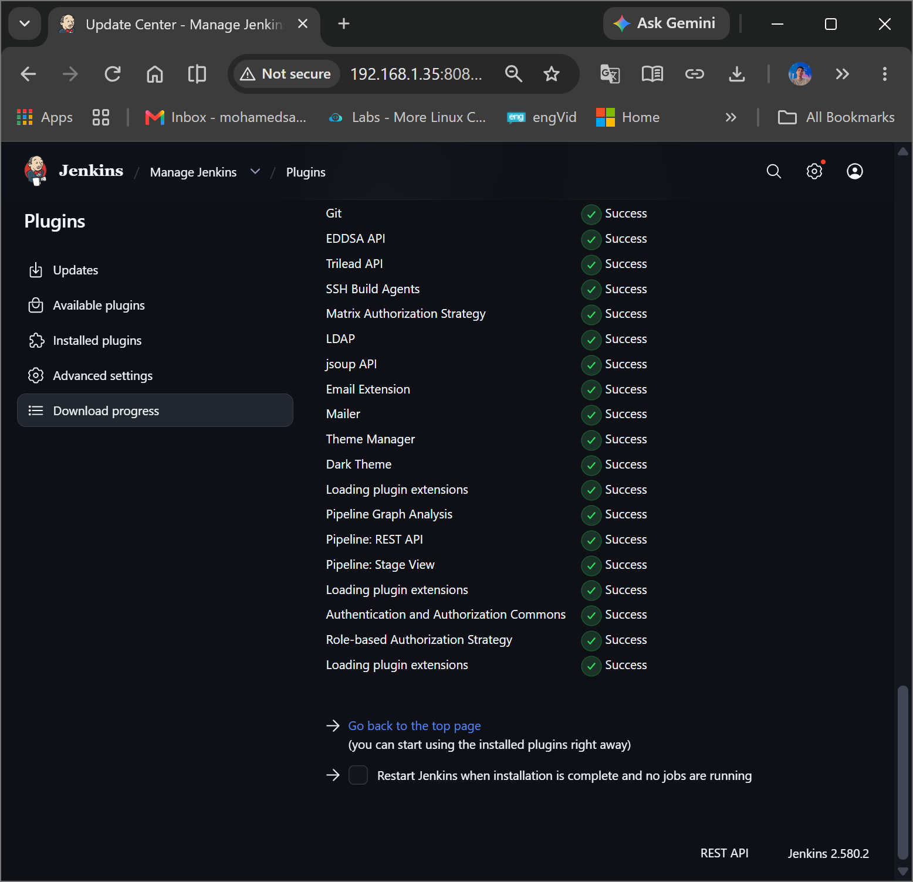
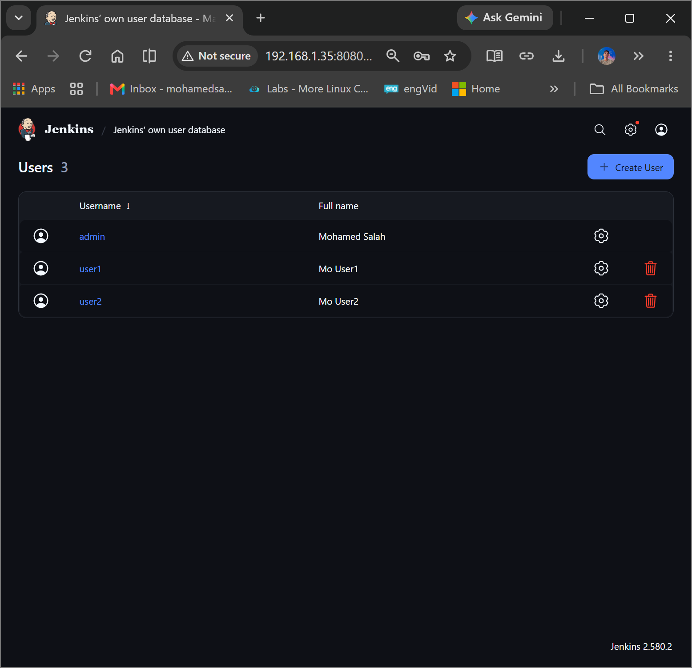
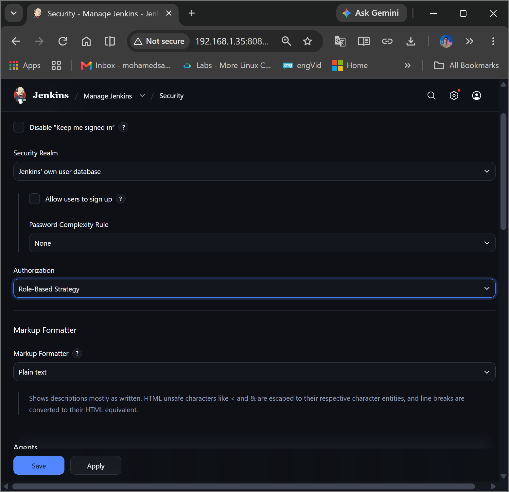
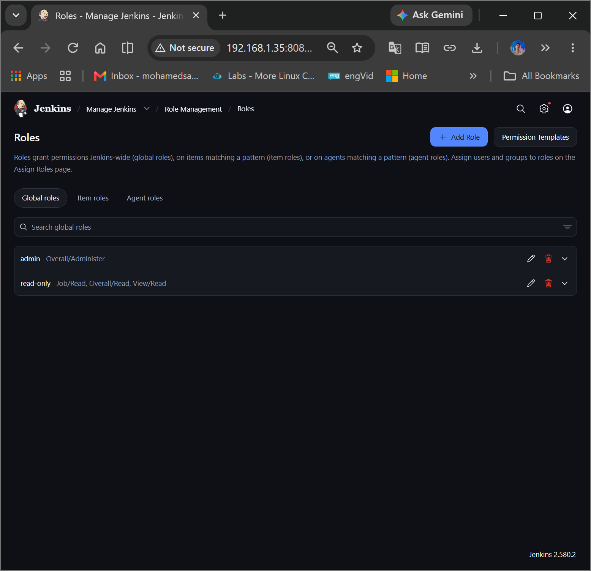
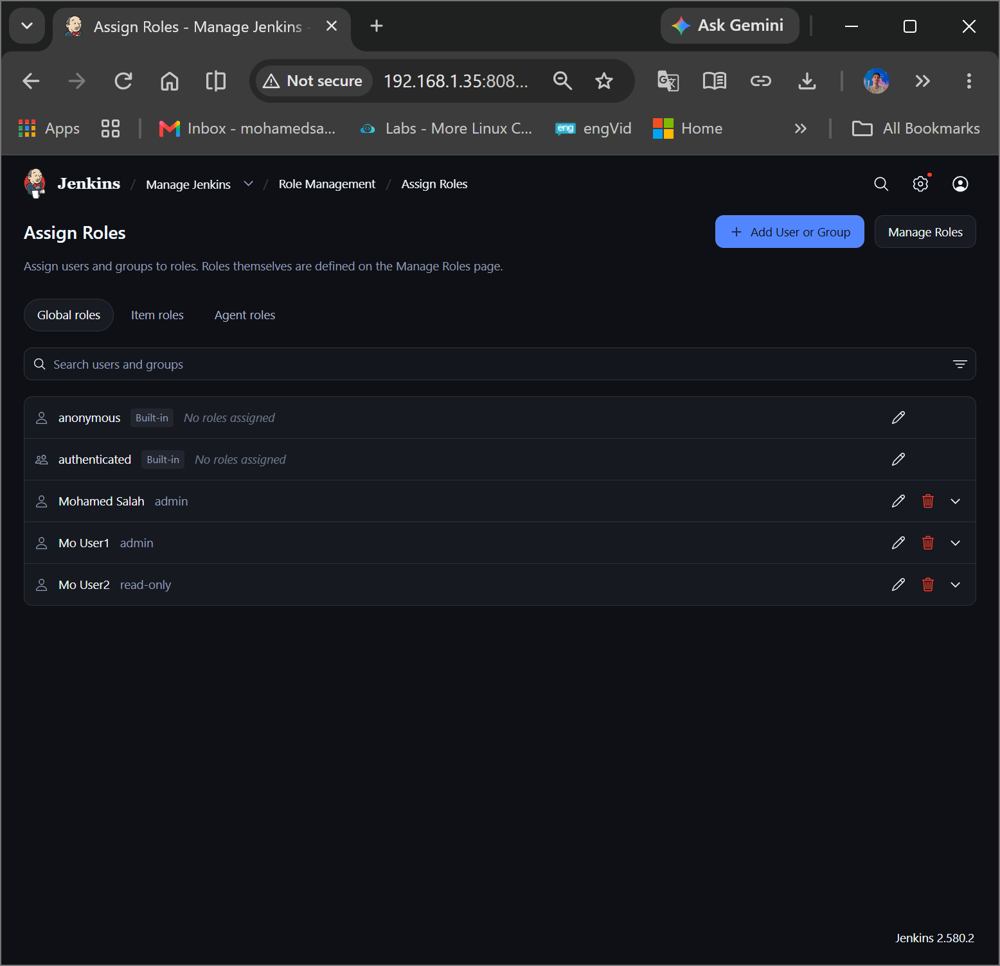
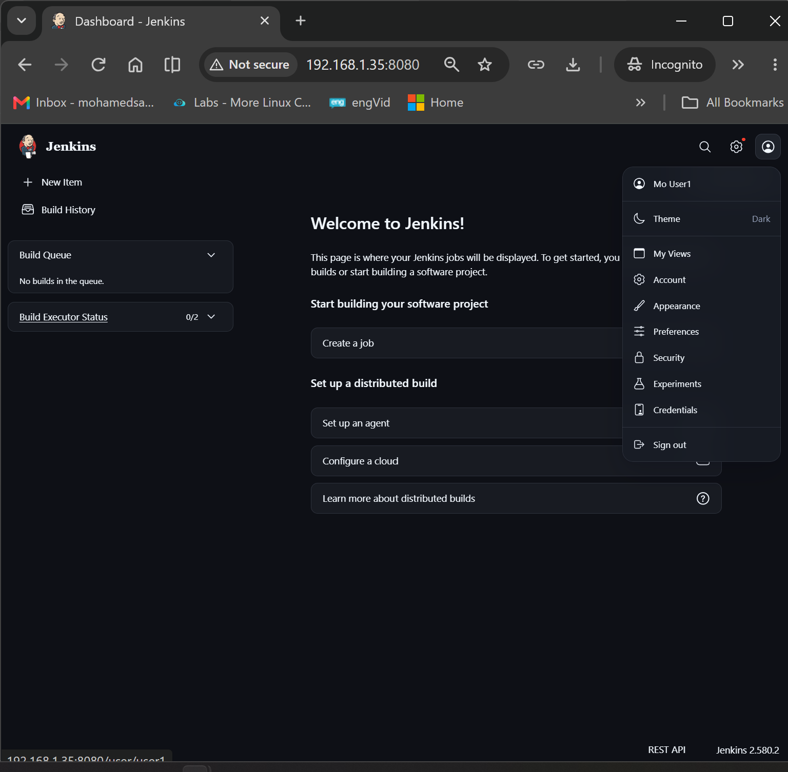
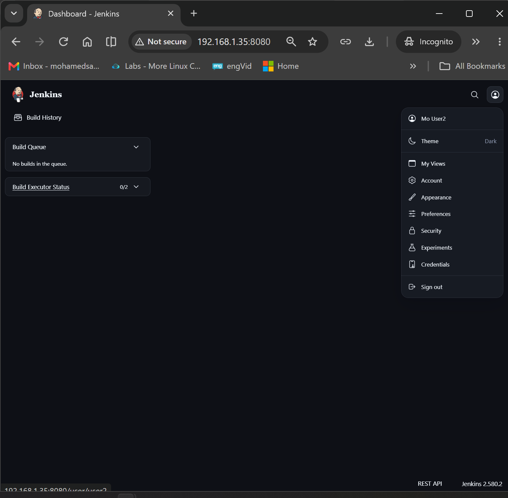
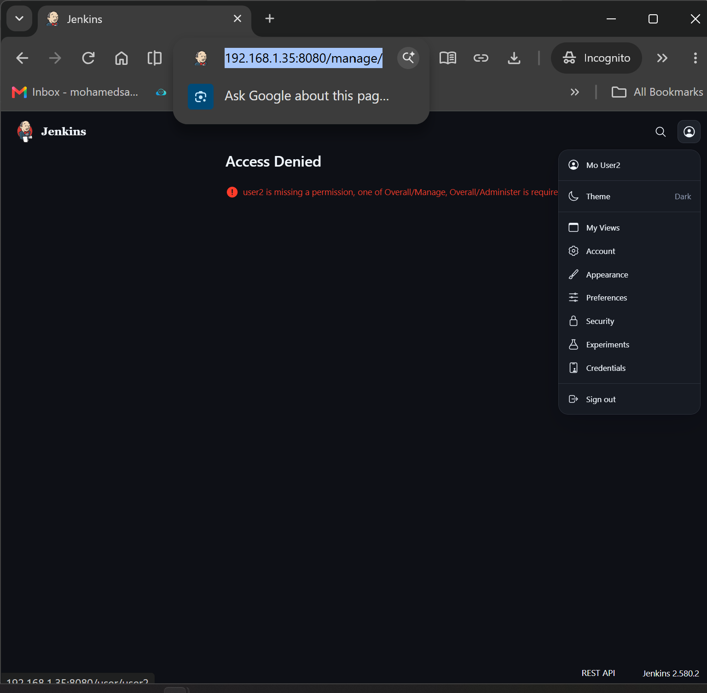

# Lab 20: Role-based Authorization in Jenkins

## Objective
- Create `user1` and `user2` in Jenkins.
- Assign the **admin** role to `user1` and a **read-only** role to `user2`.

## Environment
| Item | Value |
|------|-------|
| Jenkins | 2.580.2 (installed from the official Jenkins apt repository) |
| Host | `master` node (Ubuntu 22.04) of the 3-VM cluster |
| Java | OpenJDK 21 |
| URL | `http://192.168.1.35:8080` |
| Plugin | Role-based Authorization Strategy |

## Steps

### 1. Install the Role-based Authorization Strategy plugin
**Manage Jenkins → Plugins → Available plugins**, search for `Role-based Authorization Strategy` and install it.

### 2. Create the users
**Manage Jenkins → Users → Create User** to create `user1` and `user2`.

### 3. Enable Role-Based Strategy
**Manage Jenkins → Security → Authorization → Role-Based Strategy**, then Save.

### 4. Define the roles
**Manage Jenkins → Manage and Assign Roles → Manage Roles**
- `admin`: Overall → Administer
- `read-only`: Overall → Read, Job → Read, View → Read

### 5. Assign the roles
**Manage and Assign Roles → Assign Roles**
- `user1` → `admin`
- `user2` → `read-only`

## Verification

### user1 (admin)
`user1` can see **New Item** and **Manage Jenkins**.

### user2 (read-only)
`user2` can only view; there is no **New Item** or **Manage Jenkins**.

### user2 accessing `/manage`
Access is denied.

## Result
Role-based authorization works as expected: `user1` has full administrative access, while `user2` has read-only access.
