# Lab 21: Jenkins Pipeline for Application Deployment

## Objective
Build a Jenkins pipeline that automates the full delivery of the Spring Boot `DemoApp`:

1. Build the app
2. Build the Docker image
3. Scan the Docker image
4. Push the image to Docker Hub
5. Delete the image locally
6. Update the image in the deployment file
7. Deploy to the Kubernetes cluster

plus pipeline **post actions** (`always`, `success`, `failure`).

## Environment
| Item | Value |
|------|-------|
| Jenkins | 2.580.2 on the `master` node of the 3-VM cluster |
| Java / Maven | OpenJDK 21 (JDK) / Maven 3.6.3 |
| Image scanner | Trivy |
| Registry | Docker Hub (`mosala7320/demoapp`) |
| Application | Spring Boot (Java 17), forked from `Ibrahim-Adel15/DemoApp` |
| Kubernetes | kubeadm cluster, namespace `demo`, Service type NodePort `30090` |

## Files in this lab
- [`Jenkinsfile`](Jenkinsfile): the pipeline definition.
- [`k8s/deployment.yaml`](k8s/deployment.yaml): Deployment (2 replicas). The pipeline replaces its image tag on every build.
- [`k8s/service.yaml`](k8s/service.yaml): NodePort Service `demoapp-svc` on port `30090`.

## Steps

### 1. Fork the repository
The pipeline needs a repository where the Kubernetes manifests and the `Jenkinsfile` can be added, so I forked `DemoApp` to my GitHub account.

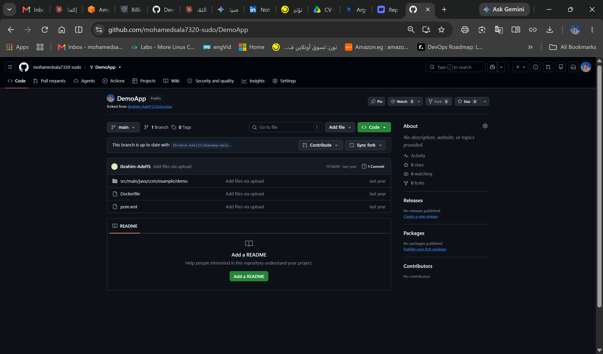

### 2. Add the Kubernetes manifests
Added `k8s/deployment.yaml` and `k8s/service.yaml` to the fork and created the `demo` namespace:

```bash
kubectl create namespace demo
```

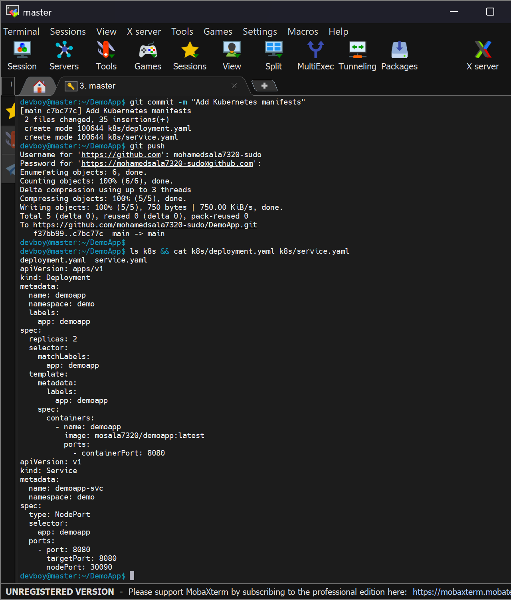

### 3. Install the tools on the Jenkins server
Installed Maven and Trivy on the master node and gave the `jenkins` user access to Docker and the cluster.

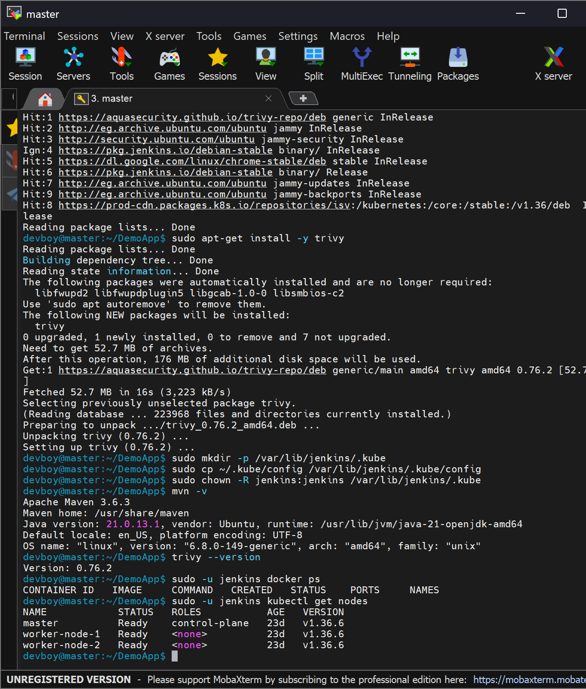

### 4. Add Docker Hub credentials to Jenkins
Created a Docker Hub access token (Read & Write) and stored it in Jenkins as `dockerhub-creds` (Username with password). The pipeline reads it with `credentials('dockerhub-creds')`, so the secret is never written in the `Jenkinsfile` and is masked in the logs.

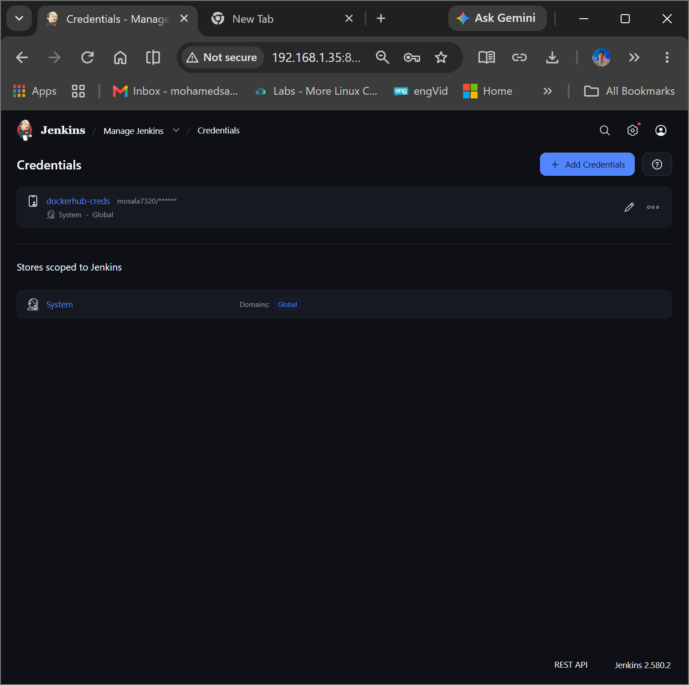

### 5. Write the Jenkinsfile
```groovy
pipeline {
    agent any

    environment {
        IMAGE      = 'mosala7320/demoapp'
        TAG        = "${BUILD_NUMBER}"
        DOCKERHUB  = credentials('dockerhub-creds')
    }

    stages {
        stage('Build App') {
            steps {
                sh 'mvn -B clean package'
            }
        }

        stage('Build Docker Image') {
            steps {
                sh 'docker build -t $IMAGE:$TAG .'
            }
        }

        stage('Scan Docker Image') {
            steps {
                sh 'trivy image --severity HIGH,CRITICAL --exit-code 0 --scanners vuln --timeout 20m --no-progress $IMAGE:$TAG'
            }
        }

        stage('Push Image to DockerHub') {
            steps {
                sh 'echo $DOCKERHUB_PSW | docker login -u $DOCKERHUB_USR --password-stdin'
                sh 'docker push $IMAGE:$TAG'
                sh 'docker logout'
            }
        }

        stage('Delete Image Locally') {
            steps {
                sh 'docker rmi $IMAGE:$TAG'
            }
        }

        stage('Update Image in Deployment File') {
            steps {
                sh "sed -i 's|image: .*|image: ${IMAGE}:${TAG}|' k8s/deployment.yaml"
                sh 'grep image: k8s/deployment.yaml'
            }
        }

        stage('Deploy to Kubernetes') {
            steps {
                sh 'kubectl apply -f k8s/'
                sh 'kubectl rollout status deployment/demoapp -n demo --timeout=180s'
            }
        }
    }

    post {
        always {
            echo "Pipeline finished with status: ${currentBuild.currentResult}"
        }
        success {
            echo 'Pipeline succeeded: the application was deployed.'
        }
        failure {
            echo 'Pipeline failed: check the console output.'
        }
    }
}
```

Notes:
- The image tag is the Jenkins `BUILD_NUMBER`, so every build produces a unique, traceable image.
- Trivy runs with `--exit-code 0`: it reports HIGH and CRITICAL vulnerabilities without failing the build, because the lab only asks for a scan.

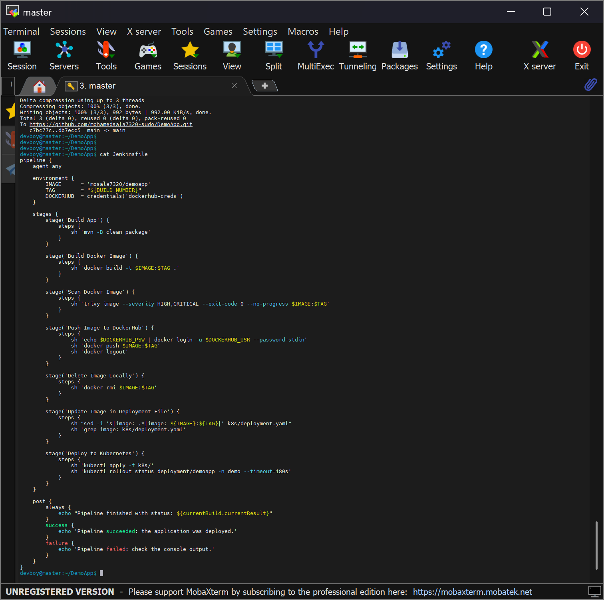

### 6. Create the pipeline job
Created a **Pipeline** job named `demoapp-pipeline` with *Pipeline script from SCM* (Git, branch `*/main`, script path `Jenkinsfile`). The repository is public, so no Git credentials are needed. The Docker Hub credential is used only inside the pipeline for the push.

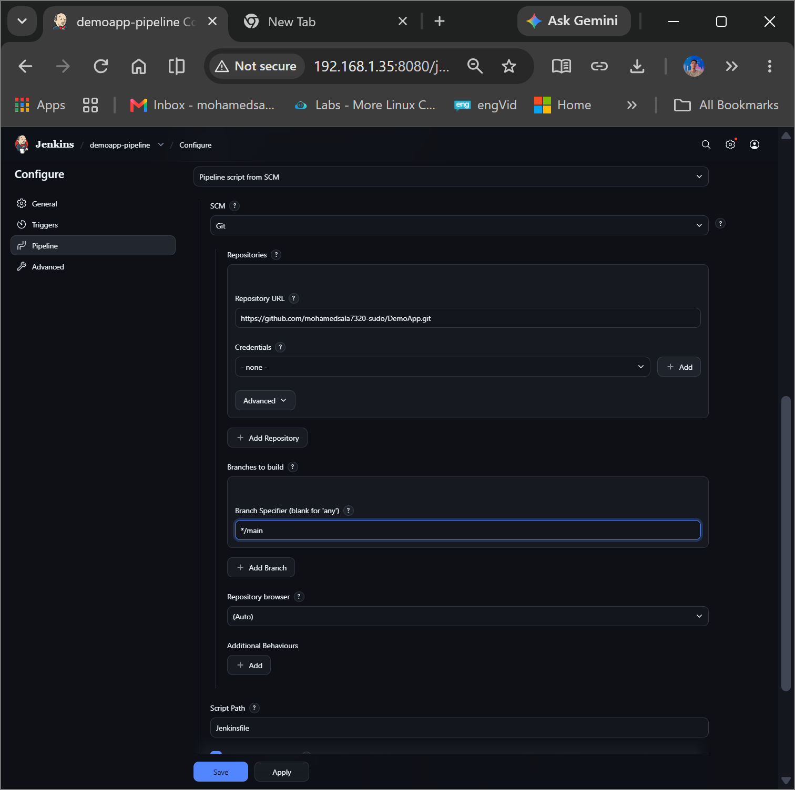

### 7. Run the pipeline
After fixing the problems described below, build **#3** passed all stages.

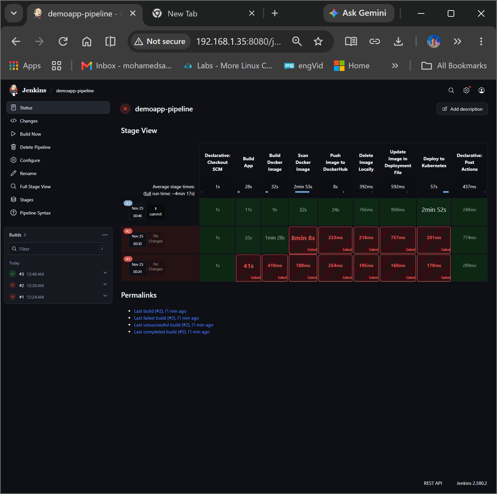

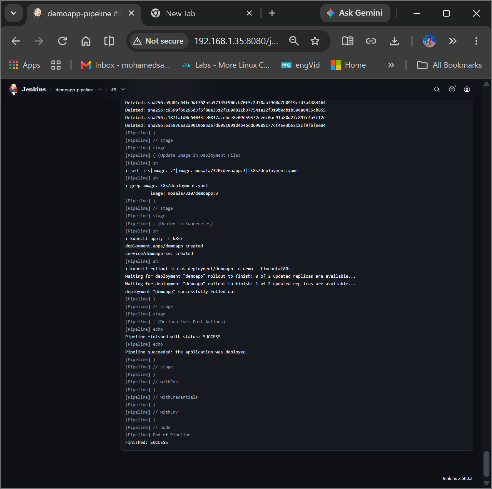

## Verification

**The image on Docker Hub** (tag `3` is the build number):

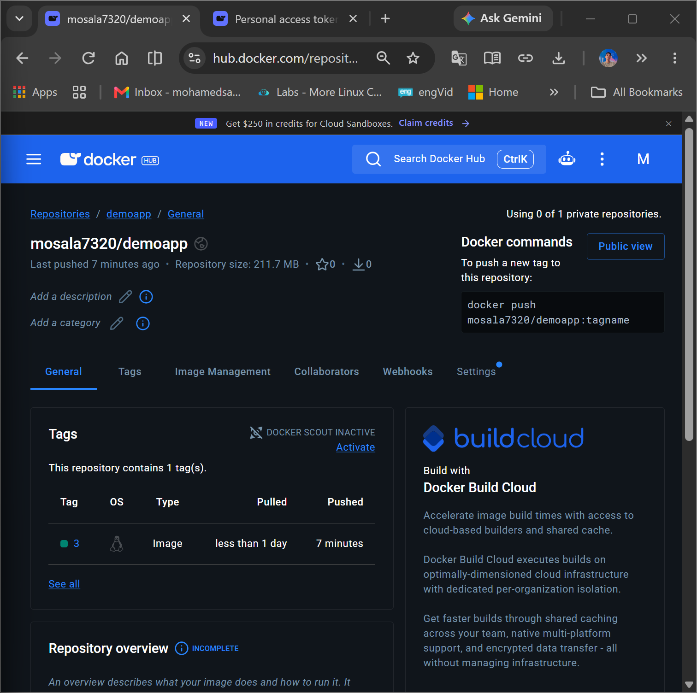

**Kubernetes resources in the `demo` namespace** (2 pods Running, NodePort Service):

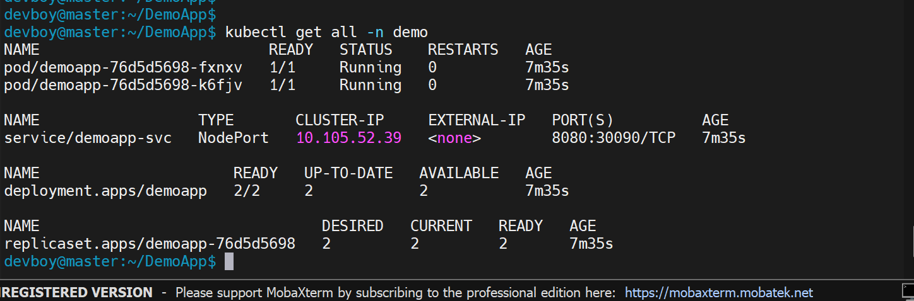

**The application responds:**

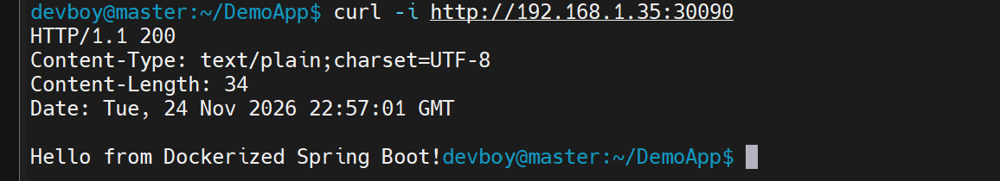

## Problems I faced and how I solved them

The stage view above shows the three runs: builds **#1** and **#2** failed and **#3** succeeded.

### Problem 1: `release version 17 not supported` (build #1)
- **Where:** `Build App` stage.
- **Symptom:** Maven downloaded all dependencies, then failed at compilation:
  ```
  Fatal error compiling: error: release version 17 not supported
  ```
- **Cause:** I had installed `openjdk-21-jre`, which is only a **runtime**. It contains no compiler (`javac`), so `mvn -v` showed Java 21 and looked healthy, but Maven could not compile the code with `release 17`.
- **Fix:** Install the full **JDK** and restart Jenkins:
  ```bash
  sudo apt install -y openjdk-21-jdk
  javac -version
  sudo systemctl restart jenkins
  ```
- **Lesson:** Any machine that builds Java code needs a **JDK**, not only a JRE.

### Problem 2: Trivy `context deadline exceeded` (build #2)
- **Where:** `Scan Docker Image` stage (it ran for about 8 minutes before failing).
- **Symptom:**
  ```
  FATAL Fatal error ... walk error: context deadline exceeded
  ```
- **Cause:** On its first run Trivy downloads two databases (vulnerabilities and Java). On my connection the Java DB alone took about 6.5 minutes, which consumed Trivy's default 5-minute timeout before the scan itself could finish. Secret scanning was also enabled and slowed the scan of a large base image.
- **Fix:** Disable the unneeded secret scanner and raise the timeout in the `Jenkinsfile`:
  ```bash
  trivy image --severity HIGH,CRITICAL --exit-code 0 --scanners vuln --timeout 20m --no-progress $IMAGE:$TAG
  ```
  The databases are now cached, so later runs only needed about 30 seconds for the scan.

### Server preparation issues
- **Disk space:** the master had only 4 GB free (83% used), which is not enough for Docker builds and the Trivy databases. I expanded the VM disk to 50 GB and grew the partition with `growpart` and `resize2fs`.
- **Docker permissions:** the `jenkins` user was added to the `docker` group (`usermod -aG docker jenkins`), otherwise the pipeline gets `permission denied` on the Docker socket.
- **kubectl access:** copied the kubeconfig to `/var/lib/jenkins/.kube/config` so the pipeline can deploy to the cluster.

### Not a problem, but worth knowing
Selecting Git credentials in the job configuration is not needed for a public repository. The credential listed there was the Docker Hub one, and using it for GitHub would make the checkout fail.

## Post actions
All three post conditions are defined and were exercised:
- `failure` ran in builds #1 and #2 (`Pipeline failed: check the console output.`).
- `success` ran in build #3 (`Pipeline succeeded: the application was deployed.`).
- `always` ran in every build and printed the final status.

## Result
The pipeline builds the application, builds and scans the Docker image, pushes it to Docker Hub, deletes the local image, updates the image tag in the deployment file, and deploys to Kubernetes. The application is reachable on `http://<node-ip>:30090`.
